# Panduan Pengguna — Neonatal Care System

> Sumber tunggal panduan ini. Versi HTML (`docs/MANUAL.html`) dihasilkan dari berkas ini
> dengan `python docs/generate_manual_html.py`. Ubah di sini, jangan di HTML-nya.

Sistem Monitoring Bayi pada Inkubator — panduan untuk perawat, dokter, dan admin.

Panduan ini disusun per peran. Cari bagian Anda, dan lewati sisanya. Perintah pemasangan
server, Docker, dan pemrograman alat **tidak** ada di sini — semuanya ada di `DEPLOYMENT.md`,
yang pembacanya berbeda.

---

## 0. Sebelum mulai

### Apa yang dikerjakan sistem ini

Tiga hal, dalam satu tempat:

1. **Memantau** — alat di setiap inkubator mengirim suhu bayi, suhu inkubator, kelembapan,
   detak jantung, dan SpO₂ setiap tiga detik. Grafiknya muncul sendiri tanpa perlu dicatat.
2. **Mencatat asesmen** — monitoring tanda vital, observasi perkembangan, keterlibatan
   keluarga, dan kolaborasi tim, mengikuti kerangka delapan pilar perawatan NICU.
3. **Melaporkan** — semua catatan seorang bayi dirangkum jadi satu laporan yang bisa
   diekspor sebagai PDF.

Yang **tidak** dikerjakan sistem ini: ia tidak memberi diagnosis, tidak mengatur suhu
inkubator, dan tidak menggantikan pemantauan langsung. Angka di layar adalah bahan
pertimbangan, bukan pengganti pemeriksaan.

### Perangkat yang bisa dipakai

| | |
|---|---|
| **Dasbor web** | Peramban di komputer bangsal. Layar lebar, cocok untuk mengisi formulir panjang dan membaca laporan. |
| **Aplikasi Android** | Untuk di samping inkubator. Isi fiturnya sama persis dengan web. |

Keduanya menampilkan data yang sama — apa pun yang dicatat di ponsel langsung terlihat di
web, dan sebaliknya.

### Masuk dan keluar

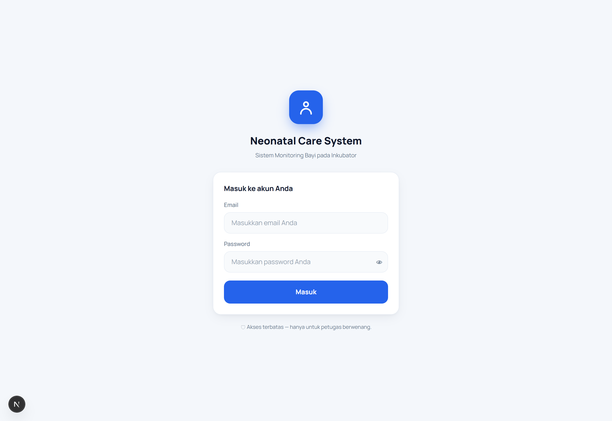

Buka alamat sistem, masukkan **email** dan **kata sandi**, tekan **Masuk**.

Kalau setelah menekan Masuk Anda kembali lagi ke halaman masuk tanpa pesan galat, itu
bukan salah ketik — laporkan ke admin. (Penyebab teknisnya ada di `DEPLOYMENT.md`.)

Tekan **Keluar** di kanan atas bila meninggalkan komputer. Sesi tidak tertutup sendiri
saat layar terkunci, dan setiap catatan tersimpan atas nama akun yang sedang masuk.

### Mengenal dasbor

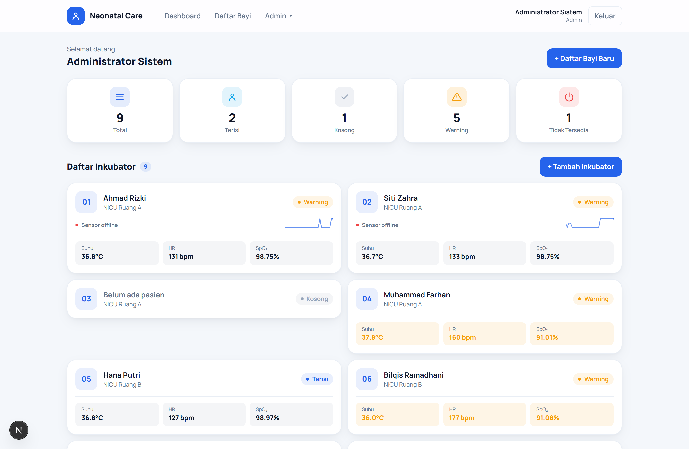

Baris kartu di atas merangkum seluruh bangsal: jumlah total, terisi, kosong, warning,
dan tidak tersedia. Di bawahnya, satu kartu per inkubator.

Warna status berarti:

| Status | Arti |
|---|---|
| **Terisi** | Ada bayi di dalamnya, semua nilai dalam batas normal. |
| **Kosong** | Siap dipakai, tidak ada bayi. |
| **Warning** | Ada bacaan sensor di luar ambang batas, **atau** modul lain menandainya. Buka detailnya untuk melihat sebabnya. |
| **Tidak Tersedia** | Ditandai admin sebagai tidak boleh dipakai — misalnya sedang diperbaiki. |

Klik satu kartu untuk membuka **Detail Inkubator**.

### Siapa boleh melakukan apa

| | Perawat | Dokter | Admin |
|---|---|---|---|
| Melihat dasbor, bayi, grafik, laporan | ya | ya | ya |
| Mendaftarkan & mengubah data bayi | ya | — | ya |
| Mencatat tanda vital, kolaborasi, keterlibatan, observasi | ya | — | ya |
| Menulis catatan dokter | — | ya | — |
| Mengelola pengguna | — | — | ya |
| Mengelola inkubator & perangkat IoT | — | — | ya |
| Membaca audit log | — | — | ya |

Menu yang bukan hak Anda tidak akan muncul. Kalau Anda membuka alamatnya langsung,
sistem akan menolak — itu perilaku yang benar, bukan kerusakan.

---

## 1. Untuk Perawat

Bagian paling tebal, karena dipakai setiap sif.

### Alur satu sif

1. Buka dasbor, lihat ada inkubator berstatus **Warning** atau tidak.
2. Untuk tiap bayi yang Anda pegang: buka detail inkubatornya, baca **Tren Sensor**.
3. Catat **Input Tanda Vital** sesuai jadwal bangsal.
4. Catat **Kolaborasi** dan **Keterlibatan** bila ada.
5. Sebelum handover, pastikan semuanya sudah masuk — laporan mengambil dari catatan ini.

### Mendaftarkan bayi baru

**Daftar Bayi → Daftar Bayi Baru.**

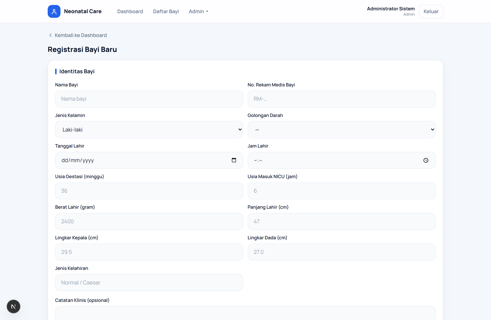

Formulirnya panjang karena merekam riwayat ibu sekaligus, dan itu disengaja: data ini
dipakai laporan dan tidak enak dikejar belakangan. Bagian yang wajib:

- **Identitas bayi** — nama, jenis kelamin, tanggal & jam lahir, berat lahir (gram),
  golongan darah, jenis kelahiran, jenis persalinan
- **Riwayat ibu** — kehamilan ke-, jumlah persalinan hidup, jumlah kunjungan ANC,
  kehamilan tunggal/kembar, penyulit (hipertensi kehamilan, diabetes gestasional,
  infeksi selama hamil), indikasi persalinan prematur
- **DPJP** — dokter penanggung jawab, dipilih dari daftar
- **Inkubator** — hanya inkubator berstatus kosong yang muncul di pilihan

Setelah disimpan, inkubator yang dipilih otomatis berubah jadi **Terisi**, dan semua
bacaan sensor dari alat di inkubator itu langsung tercatat atas nama bayi tersebut.

> **Anda tidak perlu memberi tahu alat.** Alat tidak tahu nama bayi dan memang tidak
> perlu tahu. Ia hanya melapor "ini inkubator saya"; sistem yang menentukan bayi mana
> yang sedang ada di sana. Karena itu memindahkan bayi cukup lewat aplikasi, tanpa
> menyentuh perangkat kerasnya.

### Membaca detail inkubator

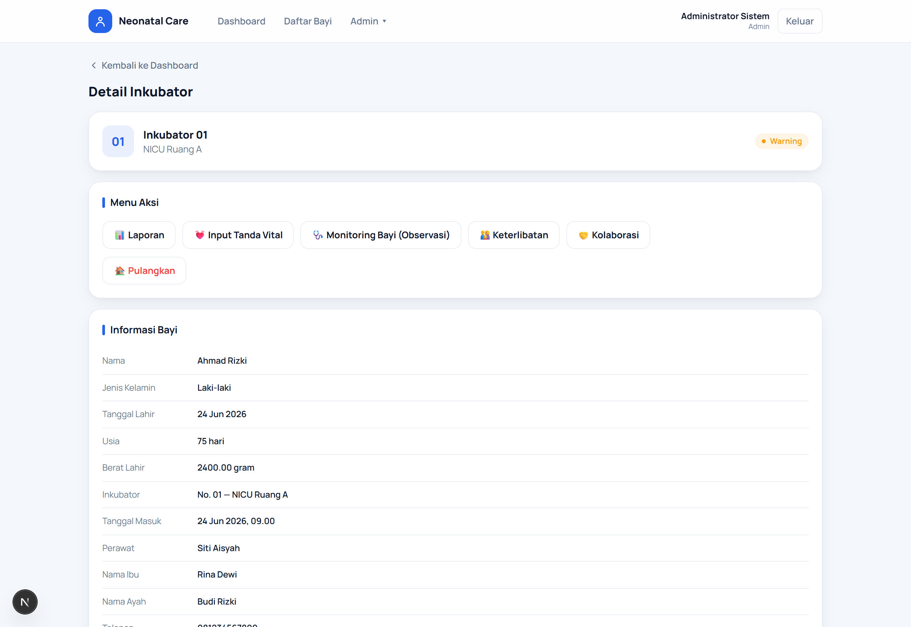

Urutannya sengaja: **Menu Aksi** di atas (yang paling sering ditekan), lalu **Informasi
Bayi**, lalu **Tren Sensor**.

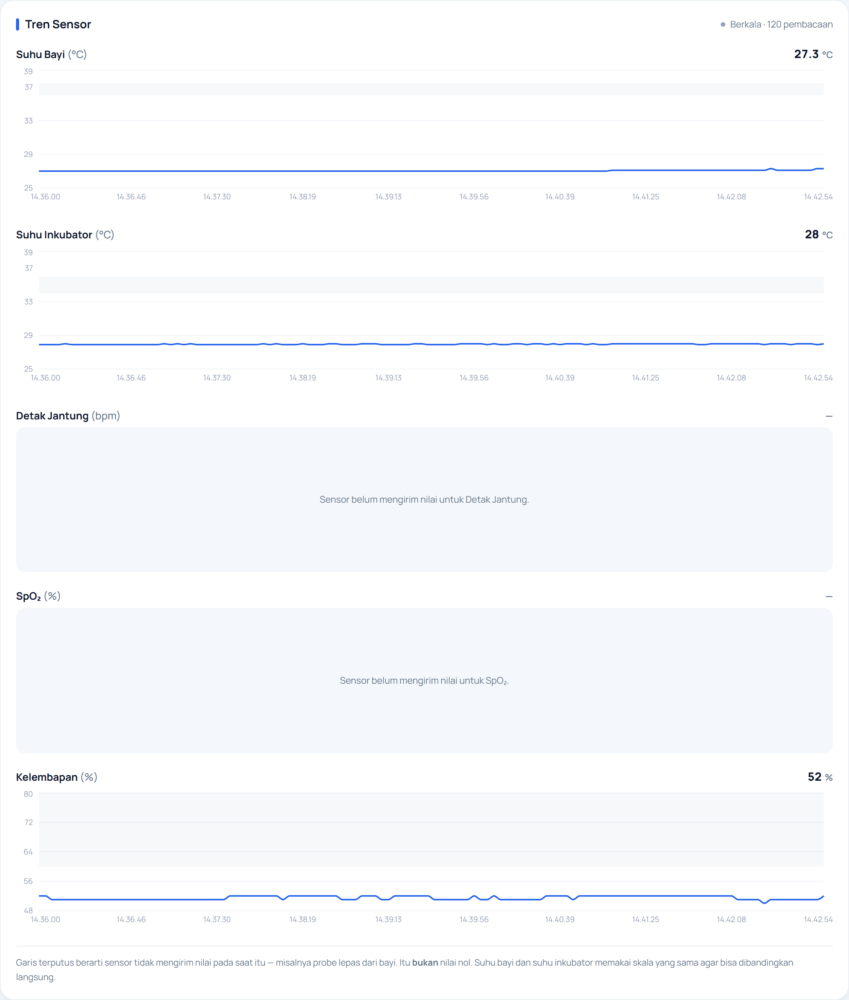

Pada **Tren Sensor**, satu panel per pengukuran, semuanya sesumbu waktu:

- Angka besar di kanan atas tiap panel adalah **nilai terakhir**.
- Pita abu-abu adalah **rentang normal** untuk pengukuran itu. Garis di dalam pita
  berarti aman.
- **Garis yang terputus berarti sensor tidak mengirim nilai saat itu** — misalnya probe
  lepas dari bayi. Itu bukan nilai nol. Grafik sengaja memutus garis supaya Anda tidak
  membaca "0 bpm" sebagai bradikardia berat.
- Label **Langsung** berarti data masuk secara real-time; **Berkala** berarti halaman
  menyegarkan sendiri tiap beberapa detik.

Bila panel tampak sebagai grafik datar di tengah pita, itu normal: bacaan yang stabil
memang menghasilkan garis lurus.

Di bawah grafik ada **Riwayat Peringatan** — daftar bacaan yang pernah keluar dari ambang
batas inkubator ini.

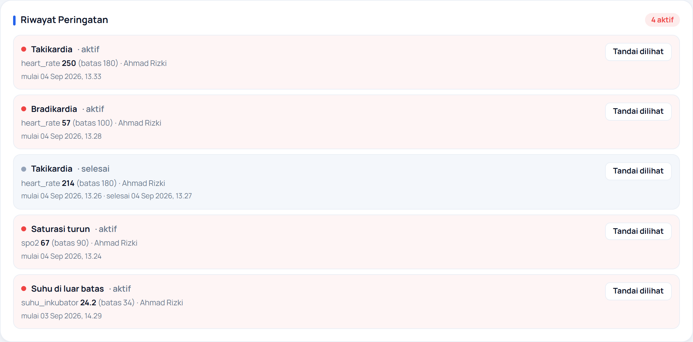

### Mencatat tanda vital

**Detail bayi → Input Tanda Vital.**

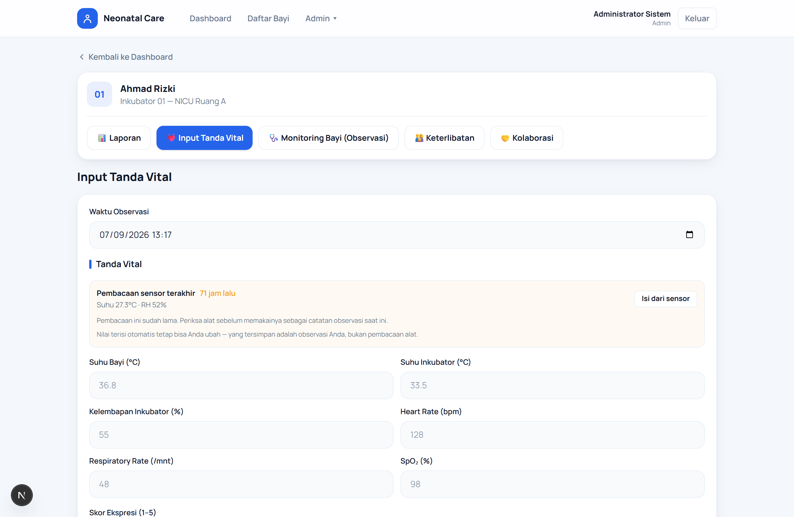

Isinya tiga kelompok:

| Kelompok | Isi |
|---|---|
| Tanda vital | Suhu Bayi (°C), Suhu Inkubator (°C), Kelembapan Inkubator (%), Heart Rate (bpm), SpO₂ (%), Respiratory Rate (/mnt) |
| Tidur & kenyamanan | Durasi Tidur (menit), Kualitas Tidur (1–5), Episode Gelisah |
| Nyeri | Skor Nyeri / NIPS (0–7), Skor Ekspresi (1–5), Skor Gerakan (1–5) |

Ditambah **Waktu Observasi**, **Catatan Observasi** (opsional), dan **Foto** (opsional,
JPEG/PNG/WebP maksimal 5 MB).

Bila inkubator punya alat yang aktif, kolom tanda vital terisi otomatis dari bacaan
terakhir. **Periksa sebelum menyimpan** — angka itu apa adanya dari sensor, dan sensor
bisa keliru bila probe lepas. Ubah angkanya bila tidak sesuai kenyataan; yang Anda simpan
adalah catatan klinis, bukan salinan sensor.

Kosongkan kolom yang tidak Anda ukur. Kosong berarti "tidak diukur"; **nol berarti
"diukur, hasilnya nol"** — dua hal yang sangat berbeda di laporan.

### Mencatat Kolaborasi Interprofesional

**Detail bayi → Kolaborasi.**

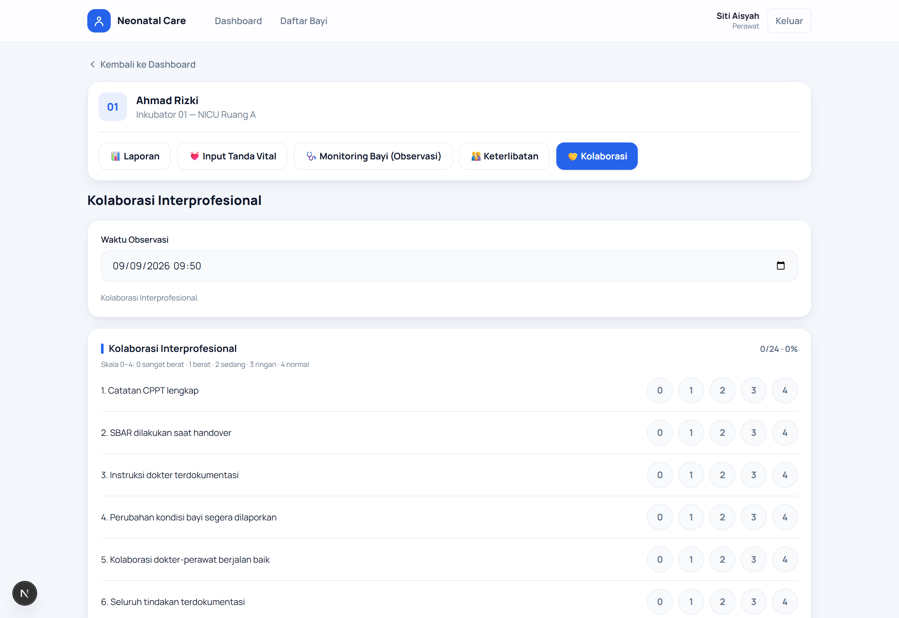

Enam pernyataan, masing-masing dinilai **0–4**, total maksimal **24**:

1. Catatan CPPT lengkap
2. SBAR dilakukan saat handover
3. Instruksi dokter terdokumentasi
4. Perubahan kondisi bayi segera dilaporkan
5. Kolaborasi dokter-perawat berjalan baik
6. Seluruh tindakan terdokumentasi

Angkanya bukan sekadar 0 sampai 4 — tiap nilai punya arti, dan sama di ketiga modul
berskor:

| Nilai | Arti |
|---|---|
| **0** | sangat berat |
| **1** | berat |
| **2** | sedang |
| **3** | ringan |
| **4** | normal |

Ini menilai **mutu dokumentasi dan komunikasi tim**, bukan kondisi bayi. Isi jujur —
gunanya untuk perbaikan proses, dan skor bagus yang tidak benar menghilangkan gunanya.

### Mencatat Keterlibatan Orang Tua

**Detail bayi → Keterlibatan.**

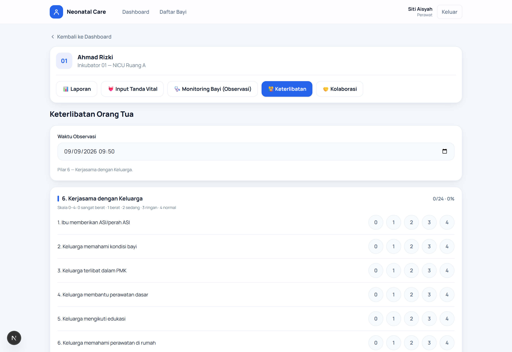

Enam pernyataan, dinilai **0–4** dengan arti yang sama seperti di atas, total maksimal **24**:

1. Ibu memberikan ASI/perah ASI
2. Keluarga memahami kondisi bayi
3. Keluarga terlibat dalam PMK (Perawatan Metode Kanguru)
4. Keluarga membantu perawatan dasar
5. Keluarga mengikuti edukasi
6. Keluarga memahami perawatan di rumah

Ditambah **Durasi Menyusui** dan **Durasi Interaksi** (menit, keduanya opsional), serta
**Kondisi Bayi Saat Interaksi**: Tenang, Aktif, Rewel, atau Tidur.

### Mencatat Monitoring Bayi (Observasi)

**Detail bayi → Monitoring Bayi (Observasi).**

> Perhatikan namanya. Tombol ini **bukan** tempat mencatat tanda vital — itu ada di
> **Input Tanda Vital**. Yang ini menilai lingkungan dan kenyamanan perkembangan bayi.

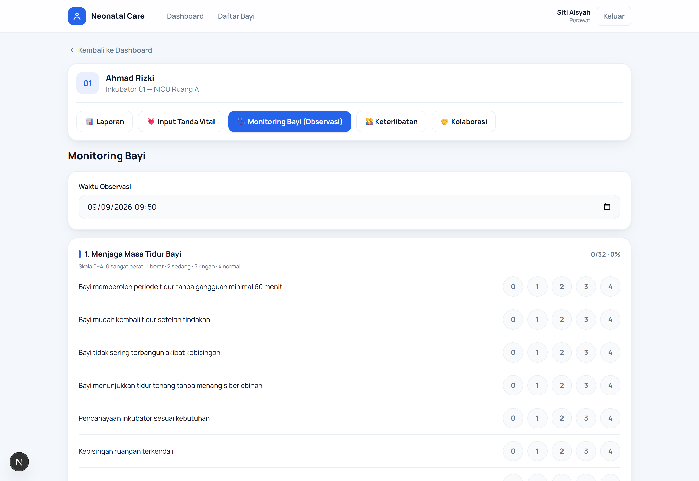

Daftar panjang (42 pernyataan, 0–4 tiap item) tentang lingkungan dan kenyamanan —
tidur tanpa gangguan minimal 60 menit, kemudahan kembali tidur, kebisingan terkendali,
pencahayaan sesuai, nesting terpasang benar, posisi bayi nyaman, dan seterusnya.

Tidak harus diisi tiap sif. Ikuti jadwal bangsal.

### Memulangkan bayi

Buka data bayi, pilih tindakan pemulangan. Inkubatornya kembali **Kosong** dan siap
dipakai bayi berikutnya. Riwayat bacaan sensor dan seluruh catatan **tetap tersimpan** —
memulangkan tidak menghapus apa pun.

---

## 2. Untuk Dokter

### Melihat kondisi dan tren

Anda bisa membuka seluruh dasbor, detail inkubator, grafik sensor, dan semua catatan
perawat. Yang tidak bisa Anda buka: manajemen pengguna dan audit log.

Saat membaca grafik, ingat aturan garis putus: **garis terputus berarti tidak ada bacaan**,
bukan nilai nol.

### Menulis Observasi Dokter

**Detail bayi → Observasi Dokter.**

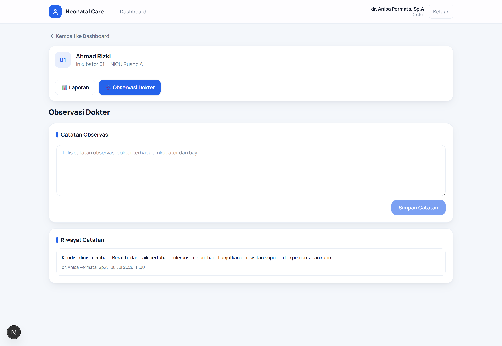

Tulis pada **Catatan Observasi**, lalu tekan **Simpan Catatan**. Catatan sebelumnya
tersusun di bawahnya pada **Riwayat Catatan**, lengkap dengan nama penulis dan waktunya.

Catatan Anda tampil di ringkasan bayi dan ikut masuk ke laporan. Hanya dokter yang bisa
menulis di sini — perawat bisa membacanya.

Perhatikan menu di atas: sebagai dokter Anda hanya melihat **Laporan** dan **Observasi
Dokter**. Tombol pencatatan milik perawat memang tidak ditampilkan untuk peran Anda.

### Laporan dan ekspor PDF

**Detail bayi → Laporan.**

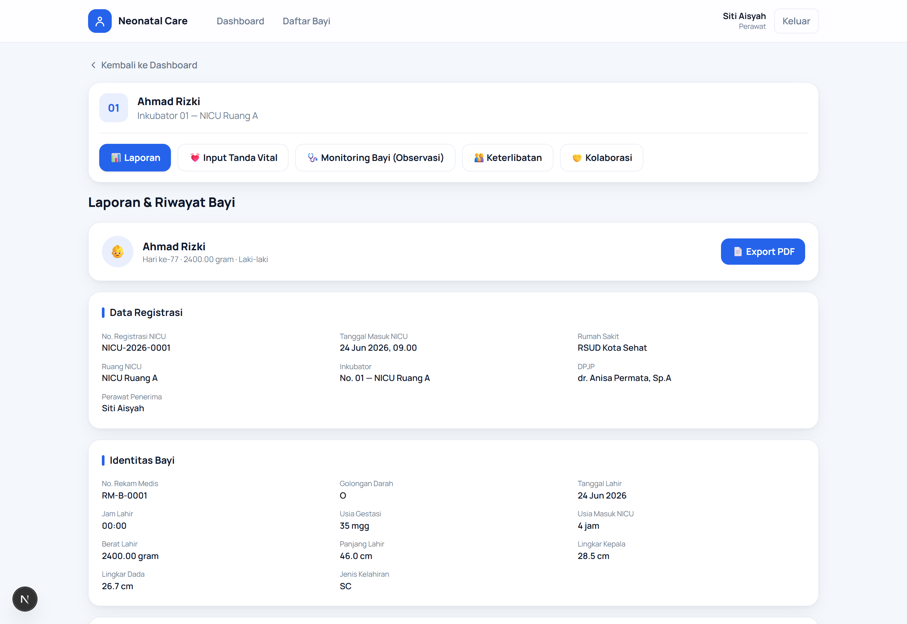

Merangkum satu bayi: identitas dan riwayat kelahiran, riwayat monitoring, observasi
terakhir, keterlibatan keluarga, skor aksi, dan catatan dokter.

Tekan **Export PDF** untuk berkas yang bisa dicetak atau dilampirkan ke rekam medis.
Isinya sama dengan yang di layar, pada saat tombol ditekan.

---

## 3. Untuk Admin

### Mengelola pengguna

**Admin → Pengguna.**

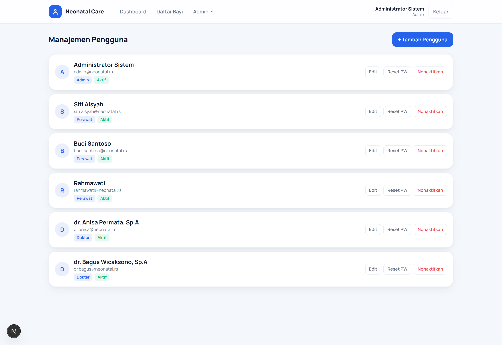

Tambah, ubah, nonaktifkan akun, dan tentukan perannya: **admin**, **perawat**, atau
**dokter**. Peran menentukan menu yang muncul dan tindakan yang diizinkan.

Beri peran sesuai pekerjaan sebenarnya. Peran admin memberi akses ke audit log dan seluruh
data pasien di bangsal.

### Mengelola inkubator

**Dasbor → Tambah Inkubator**, atau buka satu inkubator untuk mengubahnya.

Inkubator yang **masih ada riwayat penempatan bayi tidak dapat dihapus**. Tandai
**Tidak Tersedia** bila alatnya rusak atau sedang diperbaiki — itu menyembunyikannya dari
pilihan saat mendaftarkan bayi, tanpa membuang riwayatnya.

### Memasang perangkat IoT

**Detail Inkubator → kartu Perangkat IoT → Pasang Perangkat.**

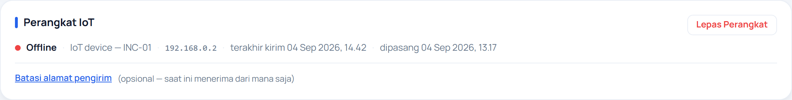

Sistem membuat **kunci perangkat** dan menampilkannya **satu kali saja**. Server hanya
menyimpan ringkasannya, jadi kunci itu tidak bisa dilihat lagi.

- **Salin kunci itu sekarang**, lalu berikan ke teknisi untuk dimasukkan ke alat.
- Kalau hilang: **Lepas Perangkat**, lalu pasang lagi untuk mendapat kunci baru — dan
  alatnya harus diprogram ulang.
- **Satu kunci untuk satu inkubator.** Memakai kunci yang sama di dua alat membuat
  keduanya tercatat sebagai perangkat yang sama.

Arti tulisan pada kartu:

| Tulisan | Arti |
|---|---|
| **Belum ada perangkat terpasang** | Belum pernah dipasang. Grafik akan kosong kecuali ada alat yang mengirim lewat jalur lama. |
| **Belum pernah mengirim data** | Perangkat terdaftar, tapi belum ada satu pun bacaan masuk. Biasanya alat belum diprogram atau salah alamat server. |
| **Online** | Ada bacaan masuk dalam 30 detik terakhir. |
| **Offline** | Pernah mengirim, tapi tidak dalam 30 detik terakhir. |
| **Mengirim tanpa terdaftar** | Ada alat yang mengirim untuk inkubator ini lewat jalur lama, tanpa terdaftar sebagai perangkat. Grafik terisi, tetapi status online dan alamat pengirim baru aktif setelah perangkat dipasang. |

**Batasi alamat pengirim** bersifat opsional dan bukan cara inkubator dipasangkan ke alat —
itu hanya penyaring tambahan. Identitas alat ditentukan oleh kunci perangkat.

### Mengatur ambang batas sensor

**Detail Inkubator → Ambang Batas Sensor.**

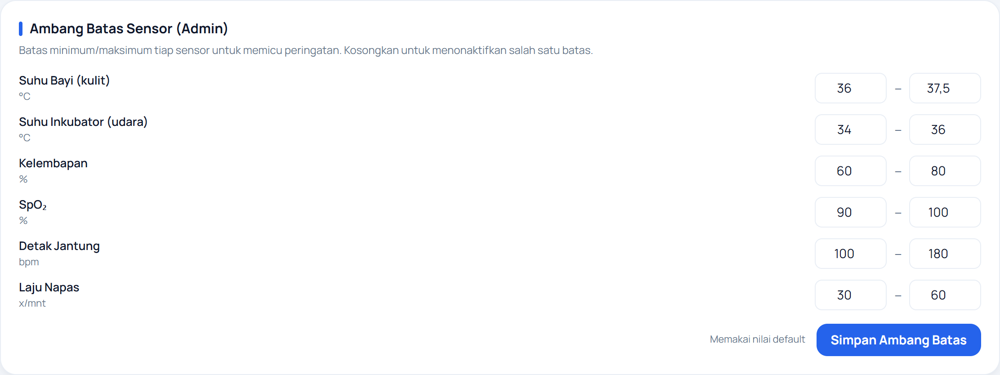

Batas bawah dan atas tiap pengukuran. Di luar rentang ini, sistem menandai inkubator
sebagai **Warning** dan mencatat peringatan. Nilai bawaan:

| Pengukuran | Bawah | Atas | Satuan |
|---|---|---|---|
| Suhu Bayi (kulit) | 36.0 | 37.5 | °C |
| Suhu Inkubator (udara) | 34.0 | 36.0 | °C |
| Kelembapan | 60 | 80 | % |
| SpO₂ | 90 | 100 | % |
| Detak Jantung | 100 | 180 | bpm |
| Laju Napas | 30 | 60 | x/mnt |

Ambang berlaku **per inkubator**, jadi bisa disesuaikan untuk bayi dengan kebutuhan khusus.
Kosongkan salah satu sisi untuk menonaktifkan batas itu saja.

Ubah dengan hati-hati: melonggarkan ambang membuat peringatan berhenti muncul, dan tidak
ada yang akan mengingatkan bahwa ambangnya yang diubah.

### Audit log

**Admin → Audit Log.**

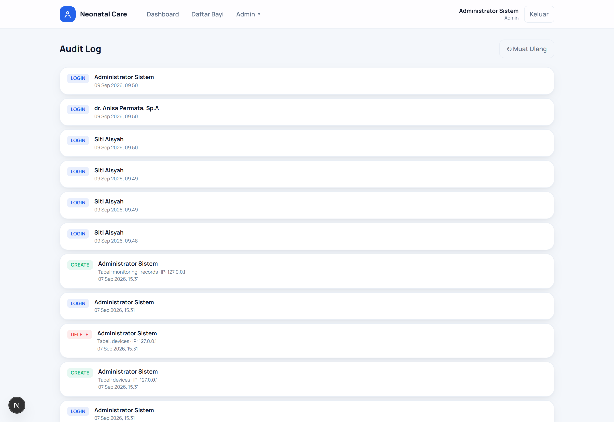

Catatan setiap perubahan data: siapa, kapan, tabel apa, dan baris mana. Bersifat
tambah-saja — tidak bisa diubah atau dihapus dari dalam aplikasi. Gunakan untuk menelusuri
"siapa yang mengubah ini".

---

## 4. Bila terjadi masalah

**Tidak bisa masuk, kembali ke halaman masuk terus.** Bila tidak ada pesan galat, ini
masalah konfigurasi server, bukan kata sandi Anda. Hubungi admin dan sebutkan bahwa
halaman masuk mengembalikan Anda tanpa pesan.

**Grafik kosong padahal alat menyala.** Urutan pemeriksaan: apakah kartu Perangkat IoT
menunjukkan **Online**? Bila tertulis **Belum pernah mengirim data**, alat belum
mengirim apa pun — kemungkinan alamat server pada alat salah, atau kunci perangkatnya
bukan kunci dari server ini. Bila tertulis **Mengirim tanpa terdaftar**, data masuk tetapi
perangkatnya belum dipasang. Keduanya ditangani admin/teknisi.

**Kartu berbunyi "Mengirim tanpa terdaftar".** Bukan kerusakan. Ada alat yang mengirim
lewat jalur lama. Minta admin menekan **Pasang Perangkat** pada inkubator itu.

**Data yang baru dicatat tidak muncul.** Muat ulang halaman. Bila tetap tidak ada,
periksa apakah Anda mencatatnya pada bayi yang benar — mudah tertukar bila membuka
beberapa tab.

**Grafik satu panel tampak sebagai kotak abu-abu penuh.** Sudah diperbaiki; bila masih
terlihat, aplikasinya versi lama. Minta admin memperbarui.

**Nilai sensor terasa tidak masuk akal.** Percayai pemeriksaan langsung, bukan layar.
Periksa pemasangan probe. Bacaan yang dikirim alat adalah apa adanya — sistem tidak
memuluskan atau mengoreksinya.

---

## Lampiran

### Daftar istilah

| Istilah | Arti |
|---|---|
| **Input Tanda Vital** | Pencatatan tanda vital, tidur, dan skor nyeri. Di sinilah angka sensor diperiksa dan disimpan sebagai catatan klinis. |
| **Monitoring Bayi (Observasi)** | Modul penilaian lingkungan dan kenyamanan perkembangan bayi — **bukan** tempat mencatat tanda vital. |
| **Keterlibatan** | Modul penilaian partisipasi keluarga: ASI, PMK, edukasi. |
| **Kolaborasi Interprofesional** | Modul penilaian kolaborasi tim — dokumentasi, handover, pelaporan. Bukan "tindakan medis". Dalam basis data dan API modul ini bernama *aksi*. |
| **Observasi Dokter** | Catatan medis yang ditulis dokter. Hanya dokter yang dapat menulis; peran lain membacanya. |
| **PMK** | Perawatan Metode Kanguru. |
| **CPPT** | Catatan Perkembangan Pasien Terintegrasi. |
| **SBAR** | Situation–Background–Assessment–Recommendation, format serah terima. |
| **NIPS** | Neonatal Infant Pain Scale, skor nyeri 0–7. |
| **DPJP** | Dokter Penanggung Jawab Pelayanan. |
| **Perangkat IoT** | Alat sensor di inkubator yang mengirim data otomatis. |
| **Kunci perangkat** | Kode identitas alat. Ditampilkan sekali saat pemasangan. |
| **Ambang batas** | Rentang normal per pengukuran; di luar itu memicu Warning. |

### Skor maksimal tiap modul

| Modul | Jumlah item | Skor per item | Maksimal |
|---|---|---|---|
| Kolaborasi Interprofesional | 6 | 0–4 | 24 |
| Keterlibatan Orang Tua | 6 | 0–4 | 24 |
| Monitoring Bayi (Observasi) | 42 | 0–4 | 168 |

Arti nilainya sama di ketiganya: **0** sangat berat · **1** berat · **2** sedang ·
**3** ringan · **4** normal.

### Yang tidak ada di panduan ini

Pemasangan server, Docker, pembaruan sistem, pemrograman alat, dan sertifikat HTTPS ada di
`DEPLOYMENT.md`. Rincian teknis endpoint API ada di `docs/api/api.html`.
