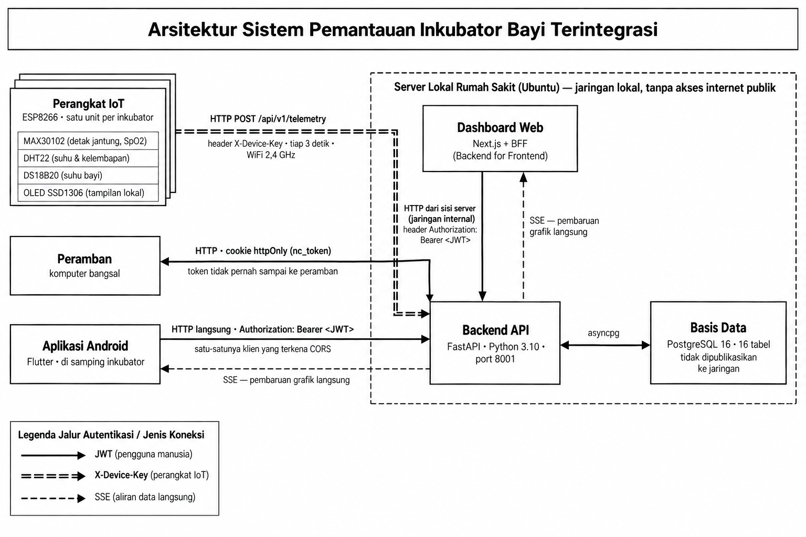
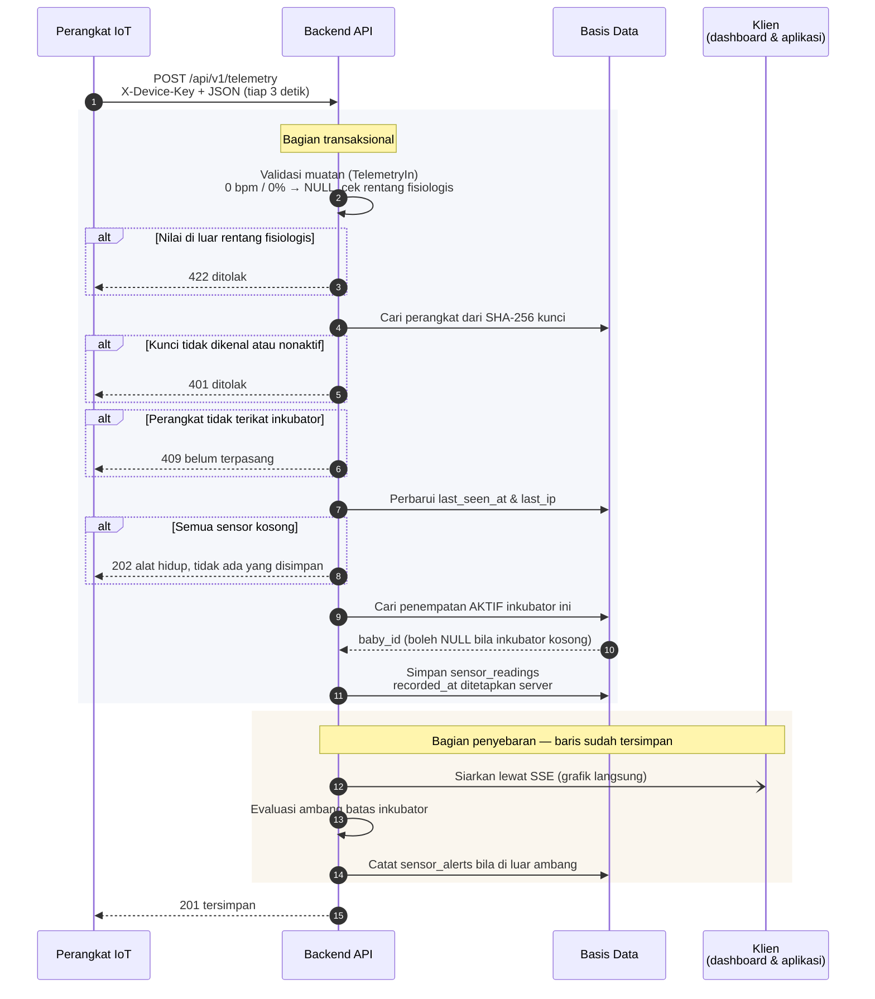

# Spesifikasi Kebutuhan Perangkat Lunak (SRS)

## Sistem Pemantauan Inkubator Bayi Terintegrasi Berbasis Internet of Things

| | |
|---|---|
| **Nama sistem** | Neonatal Care System — Sistem Monitoring Bayi pada Inkubator |
| **Versi dokumen** | 1.0 |
| **Tanggal** | 7 September 2026 |
| **Status** | Untuk ditinjau dan disetujui Klien |
| **Pengembang** | Sofyan Tandungan |
| **Dasar** | Perjanjian Kerja Sama Pengembangan Sistem Pemantauan Inkubator Bayi Terintegrasi (IoT), Pasal 2 & 3 |

Dokumen ini adalah salah satu deliverable yang disyaratkan Kontrak Pasal 3.1:
*"Dokumen SRS (Software Requirements Specification) yang telah disetujui."*

Struktur mengikuti IEEE Std 830 dengan penyesuaian pada Bab 4, yang disusun mengikuti
**tujuh komponen pekerjaan** pada Kontrak Pasal 2.2 agar ketertelusurannya langsung terlihat.

---

## Daftar Isi

1. Pendahuluan
2. Deskripsi Umum
3. Kebutuhan Antarmuka Eksternal
4. Kebutuhan Fungsional
5. Kebutuhan Non-Fungsional
6. Kebutuhan Data
7. Batasan Perancangan
8. Matriks Ketertelusuran
9. Lampiran

---

## 1. Pendahuluan

### 1.1 Tujuan

Dokumen ini menetapkan kebutuhan fungsional dan non-fungsional Sistem Pemantauan
Inkubator Bayi Terintegrasi. Ia menjadi dasar bersama antara Klien dan Pengembang untuk
pengembangan, pengujian, dan penerimaan sistem (UAT).

Pembaca yang dituju: Klien dan tenaga medis penggunanya, Pengembang, serta penguji yang
menyusun dan menjalankan UAT.

### 1.2 Ruang Lingkup

Sistem mengubah inkubator konvensional menjadi platform perawatan neonatal terhubung,
dengan tiga kemampuan utama:

1. **Pemantauan otomatis** — perangkat IoT pada tiap inkubator membaca tanda vital bayi
   dan kondisi lingkungan inkubator, lalu mengirimkannya ke server secara berkala tanpa
   campur tangan operator.
2. **Pencatatan asesmen klinis** — perawat dan dokter mencatat monitoring tanda vital,
   observasi perkembangan, keterlibatan keluarga, kolaborasi tim, dan catatan medis,
   mengikuti kerangka delapan pilar perawatan NICU.
3. **Pelaporan** — seluruh catatan seorang bayi dirangkum menjadi laporan yang dapat
   diekspor sebagai PDF.

**Di luar ruang lingkup.** Sistem tidak melakukan diagnosis, tidak memberi rekomendasi
terapi, dan **tidak mengendalikan aktuator inkubator** (pemanas, humidifier). Sistem
bersifat memantau dan mencatat, bukan mengatur. Nilai yang ditampilkan adalah bahan
pertimbangan klinis, bukan pengganti pemeriksaan langsung.

### 1.3 Definisi dan Akronim

| Istilah | Arti |
|---|---|
| **NICU** | Neonatal Intensive Care Unit |
| **Perawat** | Peran pengguna; pencatat utama data klinis harian |
| **Dokter** | Peran pengguna; penulis catatan medis, pembaca laporan |
| **Admin** | Peran pengguna; pengelola akun, inkubator, perangkat, dan ambang batas |
| **Perangkat IoT / Rig** | Unit sensor pada satu inkubator (ESP8266 + sensor) |
| **Kunci perangkat** | Kredensial identitas perangkat IoT, dikirim sebagai header `X-Device-Key` |
| **Telemetri** | Data sensor yang dikirim perangkat IoT ke server |
| **Ambang batas** | Rentang nilai normal per pengukuran; di luar itu memicu peringatan |
| **Aksi** | Modul asesmen kolaborasi tim (dokumentasi, handover) — bukan tindakan medis |
| **Keterlibatan** | Modul asesmen partisipasi keluarga |
| **Observasi** | Modul asesmen lingkungan dan kenyamanan perkembangan |
| **PMK** | Perawatan Metode Kanguru |
| **CPPT** | Catatan Perkembangan Pasien Terintegrasi |
| **SBAR** | Situation–Background–Assessment–Recommendation |
| **NIPS** | Neonatal Infant Pain Scale (0–7) |
| **DPJP** | Dokter Penanggung Jawab Pelayanan |
| **BFF** | Backend for Frontend — lapisan proksi dashboard web |
| **JWT** | JSON Web Token, kredensial sesi pengguna |
| **SSE** | Server-Sent Events, kanal aliran data satu arah |
| **UAT** | User Acceptance Test |

### 1.4 Referensi

1. Perjanjian Kerja Sama Pengembangan Sistem Pemantauan Inkubator Bayi Terintegrasi (IoT), v2
2. `docs/clinical/8 pillar NICU.md` — kerangka asesmen delapan pilar
3. `docs/api/api.html` — referensi API yang dihasilkan dari skema OpenAPI aplikasi
4. `docs/MANUAL.md` — panduan pengguna
5. `DEPLOYMENT.md` — panduan instalasi dan pemeliharaan server
6. `docs/api/ERD.md` — Entity Relationship Diagram

### 1.5 Ikhtisar Dokumen

Bab 2 menjelaskan sistem secara umum dan penggunanya. Bab 3 menetapkan antarmuka
eksternal. Bab 4 — bagian inti — merinci kebutuhan fungsional per komponen kontrak.
Bab 5 menetapkan kebutuhan non-fungsional yang dapat diukur. Bab 6 dan 7 membahas data
dan batasan. Bab 8 memetakan komponen kontrak ke kebutuhan sebagai bukti kelengkapan.

---

## 2. Deskripsi Umum

### 2.1 Perspektif Produk

Sistem berdiri sendiri di jaringan lokal rumah sakit, terdiri atas empat perangkat lunak
yang berkomunikasi melalui HTTP:

*Gambar 1 — Arsitektur Sistem Pemantauan Inkubator Bayi Terintegrasi.*

Dua jalur akses yang berbeda secara arsitektural:

- **Dashboard web** menghubungi API dari sisi server melalui BFF. Token tidak pernah
  sampai ke peramban; sesi dipegang sebagai cookie `httpOnly`.
- **Aplikasi Android dan perangkat IoT** menghubungi API secara langsung. Karena itu
  keduanya — dan hanya keduanya — tunduk pada kebijakan CORS dan pada mekanisme
  autentikasi masing-masing.

Dua hal pada Gambar 1 adalah keputusan rancangan, bukan kebetulan gambar:

- **Perangkat IoT hanya menyentuh Backend API.** Tidak ada jalur dari perangkat ke
  Dashboard Web maupun ke basis data. Inilah yang membuat AE-15 dan NF-10 dapat
  ditegakkan: alat dapat menulis telemetri, dan tidak dapat membaca data pasien mana pun.
- **Peramban tidak pernah menghubungi Backend API secara langsung.** Seluruh permintaannya
  melewati BFF, yang memegang token di sisi server. Itu sebabnya token tidak dapat diakses
  skrip di peramban (F-6.6).

Basis data tidak dipublikasikan ke jaringan; ia hanya dapat dijangkau dari dalam server.

### 2.2 Fungsi Produk (ringkas)

| | |
|---|---|
| Autentikasi & otorisasi | Masuk, sesi, pembatasan berdasarkan peran |
| Pemantauan | Penerimaan telemetri, grafik tren, status daring perangkat |
| Peringatan | Deteksi nilai di luar ambang batas, riwayat peringatan |
| Manajemen bayi | Pendaftaran, rekam medis ibu, penempatan inkubator, pemulangan |
| Asesmen klinis | Monitoring, observasi, keterlibatan keluarga, aksi, catatan dokter |
| Pelaporan | Rangkuman per bayi, ekspor PDF |
| Administrasi | Pengguna, inkubator, perangkat IoT, ambang batas, audit log |

### 2.3 Karakteristik Pengguna

| Peran | Karakteristik | Frekuensi pakai |
|---|---|---|
| **Perawat** | Tenaga medis, literasi komputer dasar, bekerja bersif, sering menggunakan sambil berdiri di dekat inkubator | Beberapa kali per sif |
| **Dokter** | Tenaga medis, membaca lebih banyak daripada menulis, membutuhkan ringkasan cepat dan laporan | Harian |
| **Admin** | Petugas TI/penanggung jawab sistem, memahami konsep akun dan perangkat | Sesekali, saat konfigurasi |
| **Perangkat IoT** | Bukan manusia; klien otomatis tanpa antarmuka | Terus-menerus (tiap 3 detik) |

### 2.4 Batasan Umum

- **B-1** Sistem beroperasi di jaringan lokal rumah sakit; tidak dirancang untuk diakses
  dari internet publik tanpa penambahan TLS dan pembatasan akses.
- **B-2** Perangkat keras server, jaringan (WiFi & router), mikrokontroler, dan sensor
  disediakan Klien (Kontrak Pasal 2.4).
- **B-3** Mikrokontroler ESP8266 hanya mendukung WiFi 2,4 GHz.
- **B-4** Sistem menangani data kesehatan bayi yang bersifat sensitif; kerahasiaan diatur
  Kontrak Pasal 8.

### 2.5 Asumsi dan Ketergantungan

- **A-1** Jaringan WiFi bangsal tersedia dan menjangkau seluruh posisi inkubator.
- **A-2** Server lokal menyala terus-menerus dan memiliki catu daya yang memadai.
- **A-3** Alamat IP server bersifat tetap (statis atau reservasi DHCP). Perubahan alamat
  mengharuskan pembangunan ulang APK dan pemrograman ulang seluruh perangkat IoT, karena
  keduanya menyimpan alamat server pada saat kompilasi.
- **A-4** Sensor terpasang dengan benar oleh tenaga terlatih; sistem tidak dapat
  membedakan sensor yang lepas dari nilai yang benar-benar rendah, selain melalui
  ketiadaan nilai.
- **A-5** Setiap pengguna memiliki akun sendiri. Akun bersama membuat audit log kehilangan
  maknanya.

---

## 3. Kebutuhan Antarmuka Eksternal

### 3.1 Antarmuka Pengguna

- **AE-1** Seluruh antarmuka pengguna berbahasa Indonesia.
- **AE-2** Dashboard web dapat digunakan pada peramban modern (Chrome, Edge, Firefox)
  dengan lebar layar minimal 1280 px, dan tetap terbaca pada lebar lebih kecil.
- **AE-3** Aplikasi Android menyediakan fungsi yang setara dengan dashboard web.
- **AE-4** Status inkubator ditampilkan dengan warna dan label sekaligus, tidak dengan
  warna saja, agar tetap terbaca oleh pengguna dengan gangguan persepsi warna.

### 3.2 Antarmuka Perangkat Keras

- **AE-5** Perangkat IoT berbasis **ESP8266** (NodeMCU atau Wemos D1 Mini).
- **AE-6** Sensor yang digunakan:

  | Sensor | Besaran | Antarmuka |
  |---|---|---|
  | GY-MAX30102 | Detak jantung (bpm), SpO₂ (%) | I²C, alamat 0x57 |
  | DHT22 | Suhu dan kelembapan udara inkubator | Digital, GPIO14 (D5) |
  | DS18B20 | Suhu bayi melalui probe kulit | 1-Wire, GPIO12 (D6), pull-up 4,7 kΩ |
  | OLED SSD1306 128×64 | Tampilan lokal pada alat | I²C, alamat 0x3C |

- **AE-7** Bus I²C menggunakan SDA = GPIO4 (D2), SCL = GPIO5 (D1); catu sensor dan OLED
  3,3 V.
- **AE-8** Alat menampilkan empat halaman informasi yang bergantian otomatis tiap 3 detik:
  pulse (SpO₂ + bpm), ruang (DHT22), probe (DS18B20), dan ringkasan seluruh sensor.

### 3.3 Antarmuka Perangkat Lunak

- **AE-9** Basis data **PostgreSQL 16**.
- **AE-10** Backend **FastAPI** (Python 3.10), dijalankan dengan Uvicorn.
- **AE-11** Dashboard web **Next.js**; aplikasi mobile **Flutter** (Android).
- **AE-12** Seluruh layanan server dikemas sebagai kontainer dan dijalankan dengan
  **Docker Compose**.

### 3.4 Antarmuka Komunikasi

- **AE-13** Seluruh komunikasi menggunakan **HTTP/1.1** dengan muatan **JSON**.
- **AE-14** Sistem menyediakan **dua mekanisme autentikasi yang terpisah**:

  | Mekanisme | Untuk | Bentuk |
  |---|---|---|
  | JWT | Pengguna manusia | Header `Authorization: Bearer <token>` |
  | Kunci perangkat | Perangkat IoT | Header `X-Device-Key: <kunci>` |

- **AE-15** Perangkat IoT hanya boleh menjangkau endpoint pengiriman telemetri, dan tidak
  boleh dapat membaca data pasien mana pun.
- **AE-16** Pembaruan grafik secara langsung menggunakan **SSE**, dengan penarikan berkala
  sebagai mekanisme cadangan bila aliran tidak tersambung.

---

## 4. Kebutuhan Fungsional

Disusun mengikuti tujuh komponen pekerjaan Kontrak Pasal 2.2.

### KOM-1 — Analisa Kebutuhan Sistem

- **F-1.1** Pengembang mendokumentasikan kebutuhan fungsional dan non-fungsional dalam
  dokumen ini, untuk ditinjau dan disetujui Klien.
- **F-1.2** Perubahan kebutuhan setelah persetujuan ditangani melalui mekanisme revisi
  Kontrak Pasal 7.

### KOM-2 — Desain Database

- **F-2.1** Sistem menyimpan data pada basis data relasional dengan skema yang
  terdokumentasi beserta ERD.
- **F-2.2** Skema mencakup entitas: pengguna, inkubator, bayi, orang tua, rekam medis ibu,
  penempatan bayi–inkubator, monitoring, observasi, keterlibatan orang tua, aksi, catatan
  dokter, perangkat, pembacaan sensor, agregat pembacaan per menit, peringatan sensor, dan
  audit log.
- **F-2.3** Satu bayi hanya dapat menempati satu inkubator pada satu waktu, dan satu
  inkubator hanya dapat ditempati satu bayi pada satu waktu. Kekangan ini ditegakkan di
  tingkat basis data, bukan hanya di aplikasi.
- **F-2.4** Satu inkubator hanya dapat memiliki satu perangkat IoT terpasang.
- **F-2.5** Menghapus data induk tidak boleh menghilangkan riwayat klinis yang sah.
  Pembacaan sensor tetap tersimpan meskipun perangkatnya dilepas.

### KOM-3 — Pengembangan Server

- **F-3.1** Seluruh komponen server dapat dijalankan dengan satu perintah pada server
  lokal Klien.
- **F-3.2** Seluruh layanan menyala kembali secara otomatis setelah server dinyalakan
  ulang, tanpa campur tangan operator.
- **F-3.3** Sistem menyediakan mekanisme pencadangan basis data dan berkas unggahan yang
  terdokumentasi.
- **F-3.4** Skema basis data dibangun otomatis saat penerapan pertama, dan perubahan skema
  pada pembaruan berikutnya diterapkan otomatis saat layanan dinyalakan.
- **F-3.5** Sistem menyediakan endpoint pemeriksaan kesehatan untuk memastikan layanan
  hidup.

### KOM-4 — Pengembangan Backend dan API

#### 4.1 Autentikasi dan otorisasi

- **F-4.1** Pengguna masuk dengan email dan kata sandi, dan menerima token sesi.
- **F-4.2** Kata sandi disimpan dalam bentuk hash, tidak pernah dalam bentuk asli.
- **F-4.3** Sistem mengenali tiga peran: **admin**, **perawat**, **dokter**.
- **F-4.4** Setiap endpoint memeriksa peran pemanggil di sisi server. Penyembunyian menu
  di antarmuka bersifat kenyamanan, bukan pengamanan.
- **F-4.5** Permintaan tanpa kredensial atau dengan kredensial tidak sah ditolak dan tidak
  mengubah data apa pun.

#### 4.2 Manajemen bayi dan penempatan

- **F-4.6** Perawat dan admin dapat mendaftarkan bayi baru beserta identitas, riwayat
  kelahiran, dan rekam medis ibu (riwayat kehamilan, penyulit, indikasi prematur, jumlah
  kunjungan ANC).
- **F-4.7** Saat pendaftaran, bayi ditempatkan pada satu inkubator yang berstatus kosong.
  Inkubator tersebut otomatis berubah menjadi terisi.
- **F-4.8** Perawat dan admin dapat mengubah data bayi dan memulangkan bayi. Pemulangan
  mengembalikan status inkubator menjadi kosong dan tidak menghapus riwayat apa pun.
- **F-4.9** Bayi ditetapkan memiliki satu DPJP yang dipilih dari daftar pengguna berperan
  dokter.

#### 4.3 Asesmen klinis

- **F-4.10** Perawat dan admin dapat mencatat **monitoring** berisi tanda vital (suhu bayi,
  suhu inkubator, kelembapan, detak jantung, SpO₂, laju napas), data tidur (durasi,
  kualitas 1–5, episode gelisah), dan skor nyeri (NIPS 0–7, ekspresi 1–5, gerakan 1–5),
  disertai waktu observasi, catatan opsional, dan foto opsional.
- **F-4.11** Bila inkubator memiliki perangkat aktif, kolom tanda vital diisi awal dari
  pembacaan sensor terakhir, dan pengguna wajib dapat mengubahnya sebelum menyimpan.
- **F-4.12** Kolom yang dikosongkan disimpan sebagai *tidak ada nilai*, dan harus dapat
  dibedakan dari nilai nol.
- **F-4.13** Perawat dan admin dapat mencatat **aksi** (kolaborasi tim): 6 butir, skor 0–4
  tiap butir, maksimum 24.
- **F-4.14** Perawat dan admin dapat mencatat **keterlibatan keluarga**: 6 butir, skor 0–4,
  maksimum 24, disertai durasi menyusui, durasi interaksi, dan kondisi bayi saat interaksi.
- **F-4.15** Perawat dan admin dapat mencatat **observasi** perkembangan: 42 butir, skor
  0–4, maksimum 168.
- **F-4.16** Butir asesmen pada F-4.13 s.d. F-4.15 disajikan dari katalog di sisi server,
  sehingga seluruh klien menampilkan pertanyaan yang identik.
- **F-4.17** Hanya dokter yang dapat menulis catatan dokter; peran lain dapat membacanya.

#### 4.4 Telemetri dan peringatan

- **F-4.18** Perangkat IoT mengirim satu sampel telemetri melalui endpoint khusus dengan
  autentikasi kunci perangkat.
- **F-4.19** Server menetapkan waktu pencatatan; alat tidak menentukan waktu, karena
  ESP8266 tidak memiliki RTC.
- **F-4.20** Bayi pemilik pembacaan ditentukan server dari penempatan yang sedang aktif,
  **tidak pernah** dari muatan yang dikirim alat.
- **F-4.21** Nilai 0 pada detak jantung dan SpO₂ diperlakukan sebagai *tidak ada
  pembacaan*, bukan nilai nol.
- **F-4.22** Sampel yang seluruh sensornya kosong tidak disimpan sebagai pembacaan, namun
  tetap memperbarui waktu terakhir perangkat terlihat.
- **F-4.23** Sistem membandingkan tiap pembacaan dengan ambang batas inkubator yang
  bersangkutan, dan membuat peringatan bila berada di luar rentang.
- **F-4.24** Peringatan yang masih terbuka tidak diduplikasi untuk jenis yang sama pada
  inkubator yang sama.
- **F-4.25** Perawat dan admin dapat menandai telah membaca suatu peringatan.

Gambar 2 menunjukkan urutan penanganan satu sampel telemetri, dari alat sampai grafik di
layar. Urutannya diambil dari jalur kode yang sebenarnya, termasuk pemisahan antara bagian
transaksional dan bagian penyebaran.

*Gambar 2 — Alur penanganan satu sampel telemetri.*

Empat hal pada Gambar 2 adalah keputusan rancangan yang perlu dibaca eksplisit:

- **Alat tidak pernah menyebut bayi.** `baby_id` diambil dari penempatan aktif (langkah 12),
  bukan dari muatan. Inilah yang membuat pemindahan bayi cukup dilakukan di aplikasi tanpa
  memprogram ulang alat (F-4.20).
- **Waktu ditetapkan server** (langkah 13), karena ESP8266 tidak memiliki RTC (F-4.19, C-2).
- **`baby_id` boleh NULL** dan itu sah: inkubator kosong tetap melaporkan suhu udaranya.
- **Penyebaran terjadi setelah penyimpanan, dan tidak dapat menggagalkannya.** Baris sudah
  tersimpan sebelum SSE disiarkan dan peringatan dievaluasi, sehingga gangguan pada
  pelanggan aliran maupun mesin peringatan tidak pernah mengubah ingest yang berhasil
  menjadi galat.

#### 4.5 Pelaporan

- **F-4.26** Sistem menghasilkan laporan per bayi berisi identitas, riwayat kelahiran,
  riwayat monitoring, observasi terakhir, keterlibatan keluarga, skor aksi, dan catatan
  dokter.
- **F-4.27** Laporan dapat diekspor sebagai berkas PDF.

#### 4.6 Administrasi

- **F-4.28** Admin dapat menambah, mengubah, dan menonaktifkan akun pengguna beserta
  perannya.
- **F-4.29** Admin dapat menambah, mengubah, menghapus, dan menandai inkubator sebagai
  tidak tersedia. Inkubator yang memiliki riwayat penempatan tidak dapat dihapus.
- **F-4.30** Admin dapat memasang dan melepas perangkat IoT pada inkubator. Kunci
  perangkat ditampilkan **tepat satu kali** saat pemasangan; server hanya menyimpan
  ringkasannya.
- **F-4.31** Admin dapat mengatur ambang batas tiap pengukuran **per inkubator**, dan dapat
  menonaktifkan salah satu sisi batas dengan mengosongkannya.
- **F-4.32** Seluruh perubahan data tercatat pada audit log berisi pelaku, waktu, tabel,
  dan baris yang diubah. Audit log bersifat tambah-saja dan hanya dapat dibaca admin.

### KOM-5 — Pengembangan Aplikasi Mobile (Android)

- **F-5.1** Aplikasi Android menyediakan seluruh fungsi pada KOM-4 yang relevan bagi peran
  penggunanya.
- **F-5.2** Aplikasi menampilkan dashboard, detail inkubator beserta grafik tren sensor,
  dan seluruh formulir asesmen.
- **F-5.3** Aplikasi menampilkan pembatasan peran yang sama dengan dashboard web.
- **F-5.4** Aplikasi diserahkan dalam bentuk APK yang dapat dipasang, beserta kode
  sumbernya.

### KOM-6 — Pengembangan Website Dashboard

- **F-6.1** Dashboard menampilkan ringkasan seluruh bangsal: jumlah inkubator total,
  terisi, kosong, warning, dan tidak tersedia.
- **F-6.2** Dashboard menampilkan satu kartu per inkubator berisi status, bayi yang
  menempati, dan nilai vital terakhir.
- **F-6.3** Halaman detail inkubator menampilkan menu aksi, informasi bayi, grafik tren
  sensor, riwayat peringatan, dan — bagi admin — kartu perangkat IoT serta pengaturan
  ambang batas.
- **F-6.4** Grafik tren menampilkan pita rentang normal dan **memutus garis** pada periode
  tanpa pembacaan, sehingga ketiadaan data tidak terbaca sebagai nilai nol.
- **F-6.5** Kartu perangkat IoT membedakan dengan jelas: belum terpasang, terpasang tetapi
  belum pernah mengirim, daring, luring, dan mengirim tanpa terdaftar.
- **F-6.6** Token sesi tidak boleh dapat diakses oleh skrip di peramban.

### KOM-7 — Pengembangan Perangkat IoT

- **F-7.1** Firmware membaca detak jantung dan SpO₂ (MAX30102), suhu serta kelembapan
  inkubator (DHT22), dan suhu bayi melalui probe (DS18B20).
- **F-7.2** Firmware mengirim satu sampel ke server setiap **3 detik**.
- **F-7.3** Firmware menyertakan kunci perangkat pada setiap pengiriman sebagai identitas.
- **F-7.4** Nilai sensor yang gagal dibaca dikirim sebagai *tidak ada nilai*, bukan nol.
- **F-7.5** Alat menampilkan nilai terkini pada layar OLED lokal, sehingga tetap berguna
  saat jaringan terputus.
- **F-7.6** Bila pengiriman gagal atau ditolak server, alat memperbesar jeda pengiriman
  secara bertahap hingga maksimum 30 detik, dan kembali normal setelah satu pengiriman
  berhasil.
- **F-7.7** Kegagalan jaringan tidak boleh menghentikan pembacaan sensor maupun tampilan
  lokal.
- **F-7.8** Konfigurasi per pemasangan (SSID, kata sandi WiFi, alamat server, kunci
  perangkat) dipisahkan dari kode program dan tidak disertakan dalam repositori.
- **F-7.9** Firmware diserahkan beserta skema rangkaian elektronika dan casing sensor.

---

## 5. Kebutuhan Non-Fungsional

### 5.1 Kinerja

- **NF-1** Sistem menerima telemetri dari seluruh inkubator terpasang pada laju satu
  sampel tiap 3 detik per inkubator tanpa kehilangan data.
- **NF-2** Halaman dashboard tampil dalam waktu wajar pada jaringan lokal (≤ 3 detik pada
  kondisi normal).
- **NF-3** Grafik tren memuat riwayat awal maksimal 120 titik, kemudian diperbarui secara
  langsung.
- **NF-4** Pengiriman telemetri yang berhasil di jaringan lokal selesai di bawah 500 ms;
  alat membatasi waktu tunggu pada 500 ms agar kegagalan jaringan tidak menghambat
  pembacaan sensor.

### 5.2 Keamanan

- **NF-5** Kata sandi disimpan sebagai hash bcrypt.
- **NF-6** Kunci perangkat disimpan sebagai hash SHA-256; nilai aslinya tidak dapat dibaca
  kembali dari sistem.
- **NF-7** Sesi pengguna berlaku **480 menit (8 jam)**, setara satu sif.
- **NF-8** Seluruh pemeriksaan otorisasi dilakukan di sisi server.
- **NF-9** Kredensial dan kunci tidak boleh tercatat pada audit log maupun berkas log.
- **NF-10** Perangkat IoT tidak memiliki akses baca terhadap data pasien.
- **NF-11** Sistem menangani data kesehatan yang sensitif; akses dibatasi jaringan lokal
  rumah sakit dan setiap perubahan data dapat ditelusuri melalui audit log.
- **NF-12** Bila sistem diakses melampaui jaringan lokal, komunikasi wajib dilindungi TLS.

### 5.3 Keandalan dan Ketersediaan

- **NF-13** Seluruh layanan menyala kembali otomatis setelah server dinyalakan ulang.
- **NF-14** Kegagalan satu perangkat IoT tidak memengaruhi inkubator lain maupun layanan.
- **NF-15** Kehilangan jaringan pada alat bersifat sementara: alat terus membaca sensor,
  menampilkan nilai lokal, dan melanjutkan pengiriman saat jaringan pulih.
- **NF-16** Basis data dan berkas unggahan disimpan pada volume yang bertahan melewati
  pembaruan dan penyalaan ulang.

### 5.4 Kegunaan

- **NF-17** Seluruh antarmuka dan pesan galat berbahasa Indonesia.
- **NF-18** Pesan galat menjelaskan penyebab dan langkah pemulihan, bukan sekadar
  menyatakan kegagalan.
- **NF-19** Sistem dapat digunakan setelah pelatihan singkat dengan bantuan panduan
  pengguna.

### 5.5 Pemeliharaan

- **NF-20** Kode sumber seluruh komponen diserahkan beserta dokumentasinya.
- **NF-21** Pembaruan sistem dapat dilakukan tanpa kehilangan data pasien.
- **NF-22** Sistem menyediakan berkas log yang cukup untuk menelusuri kegagalan
  pengiriman telemetri.

### 5.6 Portabilitas

- **NF-23** Server dapat dipindahkan ke perangkat keras lain dengan menyalin repositori
  dan berkas konfigurasi, tanpa perubahan kode.
- **NF-24** Aplikasi Android berjalan pada Android 7.0 (API 24) ke atas.

---

## 6. Kebutuhan Data

### 6.1 Entitas

Enam belas tabel, dikelompokkan menurut perannya:

| Kelompok | Tabel |
|---|---|
| Identitas & akses | `users`, `audit_logs` |
| Sarana | `incubators`, `devices` |
| Pasien | `babies`, `parents`, `maternal_records`, `baby_incubator_assignments` |
| Asesmen klinis | `monitoring_records`, `observations`, `parent_involvement_records`, `aksi_records`, `doctor_notes` |
| Telemetri | `sensor_readings`, `sensor_reading_minutes`, `sensor_alerts` |

### 6.2 Retensi Data

- **D-1** Pembacaan sensor mentah disimpan selama **7 hari**.
- **D-2** Sebelum dihapus, pembacaan diringkas menjadi agregat **per menit** (rata-rata,
  minimum, maksimum, jumlah sampel) yang disimpan permanen, sehingga tren jangka panjang
  tetap tersedia tanpa menyimpan seluruh sampel mentah.
- **D-3** Proses peringkasan dan pembersihan berjalan otomatis tiap **6 jam**.
- **D-4** Data klinis yang dicatat manusia — monitoring, observasi, keterlibatan, aksi,
  catatan dokter — **tidak dihapus otomatis**.

### 6.3 Integritas

- **D-5** Nilai sensor yang tidak terbaca disimpan sebagai NULL, dan harus dapat dibedakan
  dari nol pada seluruh antarmuka.
- **D-6** Nilai di luar rentang fisiologis wajar ditolak: suhu −40…125 °C, kelembapan
  0…100 %, detak jantung 0…300 bpm, SpO₂ 0…100 %.
- **D-7** Menghapus inkubator tidak menghapus perangkat yang pernah terpasang padanya;
  perangkat menjadi tidak terikat dan tetap menyimpan identitasnya.

### 6.4 Ambang Batas Bawaan

| Pengukuran | Bawah | Atas | Satuan |
|---|---|---|---|
| Suhu bayi (kulit) | 36,0 | 37,5 | °C |
| Suhu inkubator (udara) | 34,0 | 36,0 | °C |
| Kelembapan | 60 | 80 | % |
| SpO₂ | 90 | 100 | % |
| Detak jantung | 100 | 180 | bpm |
| Laju napas | 30 | 60 | x/mnt |

Nilai ini adalah bawaan sistem dan dapat diubah admin per inkubator (F-4.31).

---

## 7. Batasan Perancangan

- **C-1** Alamat server tertanam pada APK dan firmware saat kompilasi. Perubahan alamat
  mengharuskan pembangunan ulang dan pemrograman ulang.
- **C-2** ESP8266 tidak memiliki jam waktu nyata; penentuan waktu sepenuhnya dilakukan
  server.
- **C-3** Memori instruksi ESP8266 terbatas; penambahan fitur firmware harus
  memperhitungkan sisa kapasitas.
- **C-4** Sistem berjalan di atas HTTP polos pada penerapan jaringan lokal. Penambahan TLS
  memerlukan nama domain dan disiapkan sebagai konfigurasi terpisah.
- **C-5** Satu perangkat IoT hanya melayani satu inkubator.

---

## 8. Matriks Ketertelusuran

Memastikan seluruh komponen Kontrak Pasal 2.2 dan deliverable Pasal 3.1 tercakup.

### 8.1 Komponen pekerjaan → kebutuhan

| # | Komponen (Kontrak 2.2) | Kebutuhan |
|---|---|---|
| 1 | Analisa Kebutuhan Sistem | F-1.1, F-1.2 |
| 2 | Desain Database | F-2.1 – F-2.5, D-1 – D-7 |
| 3 | Pengembangan Server | F-3.1 – F-3.5, NF-13, NF-16, NF-21, NF-23 |
| 4 | Pengembangan Backend & API | F-4.1 – F-4.32, NF-1, NF-5 – NF-12 |
| 5 | Pengembangan Aplikasi Mobile | F-5.1 – F-5.4, NF-24 |
| 6 | Pengembangan Website Dashboard | F-6.1 – F-6.6, NF-2, NF-3 |
| 7 | Pengembangan Perangkat IoT | F-7.1 – F-7.9, NF-4, NF-14, NF-15 |

### 8.2 Deliverable → sumber

| Deliverable (Kontrak 3.1) | Wujud |
|---|---|
| Dokumen SRS yang disetujui | Dokumen ini |
| Desain database beserta ERD | `docs/api/ERD.md`, `backend/database/schema.sql` |
| Source code Backend & API terdokumentasi | `backend/`, `docs/api/api.html` |
| Aplikasi mobile (APK) beserta source code | `frontend/`, APK hasil build |
| Website dashboard beserta source code | `web/` |
| Firmware IoT beserta skema rangkaian | `hardware/allsensors/` |
| Dokumen teknis, panduan instalasi & penggunaan | `DEPLOYMENT.md`, `docs/MANUAL.md` |
| Laporan pengujian sistem (UAT Report) | **Belum disusun** — lihat 9.2 |

---

## 9. Lampiran

### 9.1 Peta Hak Akses

| Kemampuan | Perawat | Dokter | Admin | Perangkat |
|---|---|---|---|---|
| Melihat dashboard, bayi, grafik, laporan | ✓ | ✓ | ✓ | — |
| Mendaftarkan & mengubah data bayi | ✓ | — | ✓ | — |
| Mencatat monitoring, aksi, keterlibatan, observasi | ✓ | — | ✓ | — |
| Menandai peringatan telah dibaca | ✓ | — | ✓ | — |
| Menulis catatan dokter | — | ✓ | — | — |
| Mengelola pengguna | — | — | ✓ | — |
| Mengelola inkubator, perangkat, ambang batas | — | — | ✓ | — |
| Membaca audit log | — | — | ✓ | — |
| Mengirim telemetri | — | — | — | ✓ |

### 9.2 Catatan Status untuk Peninjau

Bagian ini **bukan bagian dari kebutuhan**; disertakan agar peninjau mengetahui keadaan
saat dokumen disusun.

| Hal | Keadaan |
|---|---|
| Backend, dashboard, aplikasi mobile, perangkat IoT | Terbangun dan berjalan |
| Penerapan pada server lokal Klien | Sudah berjalan |
| Pengujian firmware terhadap server yang hidup | **Belum** dilakukan uji ujung-ke-ujung |
| TLS (NF-12) | Disiapkan sebagai konfigurasi terpisah, **belum diuji** |
| Laporan UAT | Belum disusun; kebutuhan berkode pada dokumen ini dimaksudkan sebagai dasar penyusunannya |

### 9.3 Riwayat Dokumen

| Versi | Tanggal | Perubahan |
|---|---|---|
| 1.0 | 7 September 2026 | Penyusunan awal. Kebutuhan diturunkan dari Kontrak v2, kerangka delapan pilar, dan sistem yang telah terbangun. |
