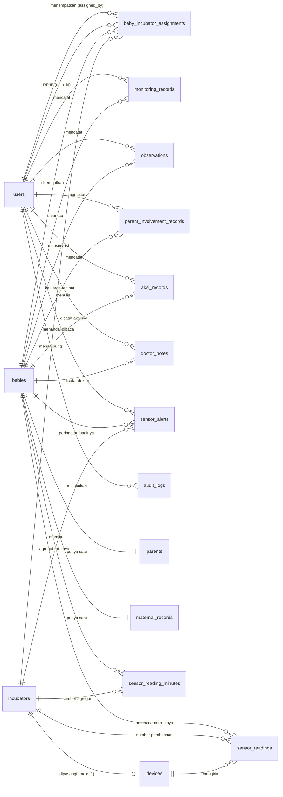
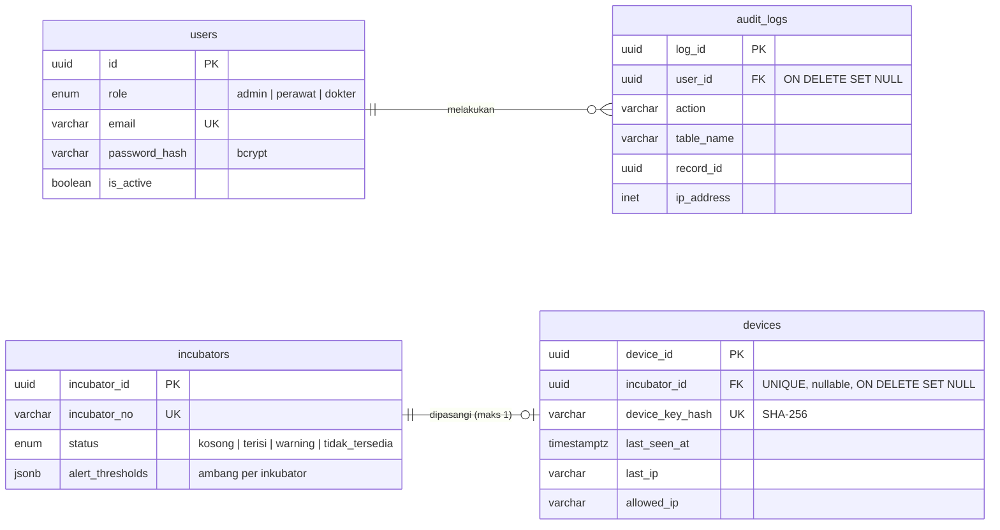
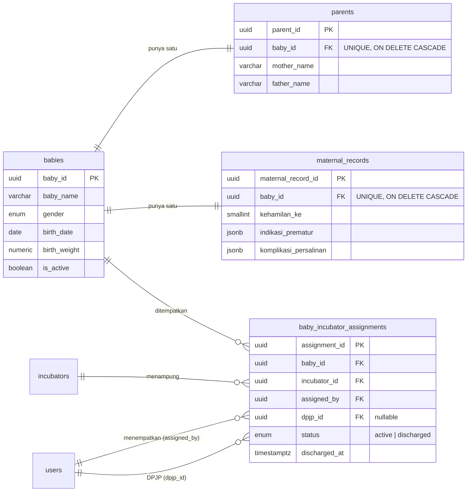
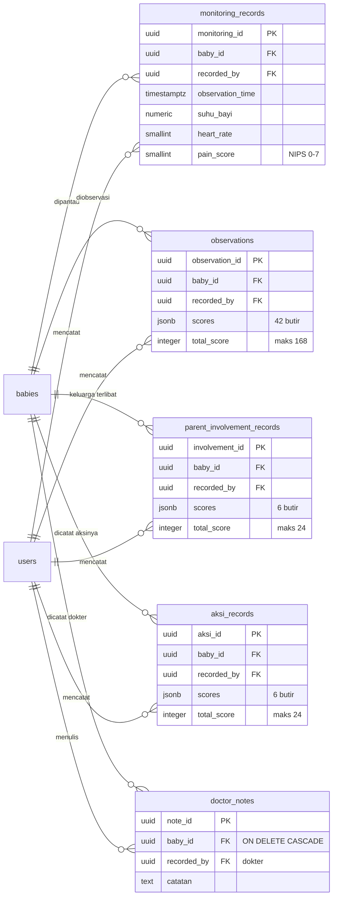
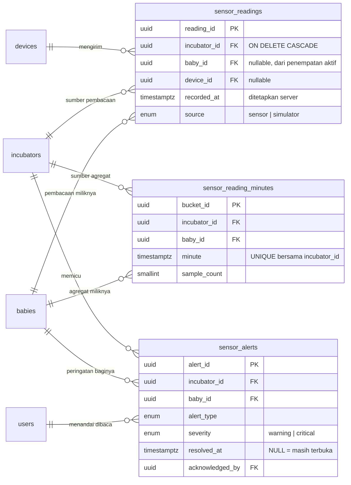

# Entity Relationship Diagram — Neonatal Care System

> Basis data: **PostgreSQL 16** · ORM: **SQLAlchemy 2.0** (async) · Migrasi: **Alembic**
> Sumber kebenaran: `backend/database/schema.sql`
> Dokumen ini mencerminkan revisi **`e8c4b2f91d37_sensor_minute_rollup`** — yaitu head
> Alembic saat ini, mencakup seluruh pekerjaan IoT (perangkat, telemetri, peringatan,
> agregat per menit).

Seluruh primary key bertipe `UUID`. Seluruh kolom waktu bertipe `TIMESTAMPTZ`
(dengan zona waktu). **16 tabel**, dikelompokkan menurut perannya:

| Kelompok | Tabel | Diagram |
|---|---|---|
| Identitas & akses | `users`, `audit_logs` | [1.2](#12-identitas-sarana-dan-jejak-audit) |
| Sarana | `incubators`, `devices` | [1.2](#12-identitas-sarana-dan-jejak-audit) |
| Pasien | `babies`, `parents`, `maternal_records`, `baby_incubator_assignments` | [1.3](#13-pasien-dan-penempatan) |
| Asesmen klinis | `monitoring_records`, `observations`, `parent_involvement_records`, `aksi_records`, `doctor_notes` | [1.4](#14-asesmen-klinis) |
| Telemetri | `sensor_readings`, `sensor_reading_minutes`, `sensor_alerts` | [1.5](#15-telemetri-iot) |

> **Cara melihat diagram.** Ditulis dengan [Mermaid](https://mermaid.js.org/), dan
> ter-*render* otomatis di **GitHub** serta di **VS Code** (pasang ekstensi *Markdown
> Preview Mermaid Support*). Bila yang tampak hanya teks `erDiagram`, buka
> [ERD.svg](ERD.svg) — seluruh diagram yang sama dalam satu gambar — atau tempelkan blok
> kodenya ke <https://mermaid.live>. Bagian 2 menjelaskan setiap kolom dalam bentuk tabel
> biasa, jadi diagramnya bersifat pelengkap, bukan syarat.
>
> Setiap diagram memakai `direction LR` agar tumbuh ke bawah, bukan ke samping. Perender
> Mermaid lama mengabaikan baris itu tanpa galat — diagramnya tetap tampil, hanya
> kembali melebar.

---

## 1. Diagram

Enam belas tabel dalam satu gambar menghasilkan diagram yang melebar jauh ke samping:
`babies`, `users`, dan `incubators` menjadi poros, sehingga hampir seluruh tabel anak
berjajar pada satu baris. Karena itu diagram dipecah — **1.1** memetakan seluruh
hubungan tanpa kolom, lalu **1.2–1.5** merinci kolom kunci per kelompok.

Setiap tabel dirinci kolomnya **tepat pada satu** diagram kelompok. Bila tabel itu muncul
lagi di kelompok lain, bentuknya hanya kotak nama — sebagai konteks, bukan pengulangan.
Daftar kolom lengkap tetap ada di Bagian 2.

### 1.1 Peta hubungan

Seluruh 16 tabel dan seluruh kunci asing, tanpa kolom.



### 1.2 Identitas, sarana, dan jejak audit

Dua pasangan yang berdiri sendiri: akun beserta jejaknya, dan inkubator beserta
perangkat IoT-nya.



### 1.3 Pasien dan penempatan

`parents` dan `maternal_records` masing-masing satu baris per bayi; penempatan boleh
berulang sepanjang riwayat bayi. `users` dan `incubators` dirinci di 1.2.



### 1.4 Asesmen klinis

Lima tabel berpola sama: milik satu bayi, dicatat oleh satu pengguna. `babies` dirinci
di 1.3, `users` di 1.2.



### 1.5 Telemetri IoT

Jalur data sensor: `devices` mengirim, `sensor_readings` menampung data mentah,
`sensor_reading_minutes` meringkasnya per menit, `sensor_alerts` menyimpan pelanggaran
ambang. Tabel poros dirinci di 1.2 dan 1.3.



---

## 2. Rincian Kolom

### 2.1 `users` — akun pengguna

| Kolom | Tipe | Keterangan |
|---|---|---|
| `id` | UUID PK | |
| `role` | `user_role` | `admin` · `perawat` · `dokter` |
| `email` | VARCHAR(255) UNIQUE | dipakai untuk masuk |
| `password_hash` | VARCHAR(255) | hash bcrypt; kata sandi asli tidak pernah disimpan |
| `full_name` | VARCHAR(255) | |
| `is_active` | BOOLEAN | akun nonaktif tidak dapat masuk |
| `created_at`, `updated_at` | TIMESTAMPTZ | |

### 2.2 `incubators` — sarana

| Kolom | Tipe | Keterangan |
|---|---|---|
| `incubator_id` | UUID PK | |
| `incubator_no` | VARCHAR(10) UNIQUE | `01`, `02`, … — dipakai firmware lama sebagai label |
| `location` | VARCHAR(255) | mis. "NICU Ruang A" |
| `status` | `incubator_status` | `kosong` · `terisi` · `warning` · `tidak_tersedia` |
| `alert_thresholds` | JSONB | ambang batas **per inkubator**; kosong berarti memakai bawaan |
| `created_at`, `updated_at` | TIMESTAMPTZ | |

### 2.3 `devices` — perangkat IoT

| Kolom | Tipe | Keterangan |
|---|---|---|
| `device_id` | UUID PK | |
| `incubator_id` | UUID FK **UNIQUE**, nullable | `ON DELETE SET NULL` — lihat catatan 4.3 |
| `device_key_hash` | VARCHAR(64) UNIQUE | SHA-256 dari kunci perangkat; kunci asli tidak dapat dibaca kembali |
| `label` | VARCHAR(100) | mis. "IoT device — INC-01" |
| `firmware_version` | VARCHAR(20) | |
| `last_seen_at` | TIMESTAMPTZ | menggerakkan lencana daring/luring |
| `last_ip` | VARCHAR(45) | provenans, **bukan** identitas |
| `allowed_ip` | VARCHAR(45) | penyaring opsional untuk jalur lama |
| `is_active` | BOOLEAN | |

### 2.4 `babies` — identitas bayi

| Kolom | Tipe | Keterangan |
|---|---|---|
| `baby_id` | UUID PK | |
| `baby_name` | VARCHAR(255) | |
| `gender` | `gender_type` | `laki_laki` · `perempuan` |
| `birth_date` | DATE | |
| `jam_lahir` | TIME | |
| `birth_weight` | NUMERIC(6,2) | gram |
| `birth_length` | NUMERIC(5,1) | cm |
| `lingkar_kepala`, `lingkar_dada` | NUMERIC(4,1) | cm |
| `gestational_age` | SMALLINT | minggu |
| `usia_masuk_nicu_jam` | SMALLINT | jam |
| `birth_type` | VARCHAR(100) | |
| `golongan_darah` | `blood_type` | `A` · `B` · `AB` · `O` |
| `no_rm_bayi` | VARCHAR(50) | nomor rekam medis |
| `clinical_notes` | TEXT | |
| `is_active` | BOOLEAN | |

### 2.5 `parents` — data orang tua (1 : 1 dengan bayi)

| Kolom | Tipe | Keterangan |
|---|---|---|
| `parent_id` | UUID PK | |
| `baby_id` | UUID FK **UNIQUE** | `ON DELETE CASCADE` |
| `mother_name`, `father_name` | VARCHAR(255) | |
| `mother_phone` | VARCHAR(20) | |
| `mother_medical_history`, `birth_history`, `delivery_history`, `additional_notes` | TEXT | |

### 2.6 `maternal_records` — rekam medis ibu (1 : 1 dengan bayi)

Tabel terlebar, karena merekam riwayat kehamilan sekaligus. Dikelompokkan:

| Kelompok | Kolom |
|---|---|
| Identitas ibu | `no_rm_ibu`, `umur_ibu`, `pendidikan`, `pekerjaan`, `alamat`, `golongan_darah` |
| Riwayat obstetri | `kehamilan_ke`, `jumlah_persalinan_hidup`, `riwayat_abortus`, `riwayat_prematur`, `riwayat_bblr`, `riwayat_bayi_meninggal` |
| Kehamilan ini | `usia_kehamilan_lahir`, `jenis_kehamilan`, `anc_rutin`, `jumlah_anc` |
| Penyulit | `hipertensi_kehamilan`, `preeklamsia`, `diabetes_gestasional`, `infeksi_hamil`, `perdarahan_hamil`, `ketuban_pecah_dini` |
| Paparan | `merokok`, `paparan_asap_rokok`, `konsumsi_alkohol`, `obat_tertentu`, `obat_tertentu_ket` |
| Persalinan | `tanggal_persalinan`, `jenis_persalinan`, `tempat_persalinan`, `indikasi_prematur` (JSONB), `indikasi_prematur_lainnya`, `komplikasi_persalinan` (JSONB), `komplikasi_lainnya` |
| Kondisi bayi lahir | `apgar_menit_1`, `apgar_menit_5` |
| Kondisi ibu pascasalin | `kondisi_umum`, `masih_dirawat`, `komplikasi_postpartum`, `dapat_berjalan`, `dapat_menyusui` |

`indikasi_prematur` dan `komplikasi_persalinan` berupa JSONB karena keduanya pilihan
ganda yang daftarnya dapat bertambah tanpa mengubah skema.

### 2.7 `baby_incubator_assignments` — penempatan bayi di inkubator

| Kolom | Tipe | Keterangan |
|---|---|---|
| `assignment_id` | UUID PK | |
| `baby_id` | UUID FK | |
| `incubator_id` | UUID FK | |
| `assigned_by` | UUID FK → `users` | yang menempatkan |
| `dpjp_id` | UUID FK → `users`, nullable | dokter penanggung jawab |
| `assigned_at` | TIMESTAMPTZ | |
| `discharged_at` | TIMESTAMPTZ, nullable | terisi saat pemulangan |
| `status` | `assignment_status` | `active` · `discharged` |
| `no_registrasi_nicu` | VARCHAR(30) UNIQUE | |
| `rumah_sakit`, `ruang_nicu` | VARCHAR | |

**Tabel inilah** yang menjawab "bayi mana yang sedang ada di inkubator ini" — dipakai server
untuk menetapkan `baby_id` pada setiap pembacaan sensor.

### 2.8 `monitoring_records` — monitoring tanda vital

| Kolom | Tipe | Keterangan |
|---|---|---|
| `monitoring_id` | UUID PK | |
| `baby_id`, `recorded_by` | UUID FK | |
| `observation_time` | TIMESTAMPTZ | waktu pengamatan, diisi pencatat |
| `suhu_bayi`, `suhu_inkubator` | NUMERIC(4,1) | °C |
| `kelembapan_inkubator` | NUMERIC(5,2) | % |
| `heart_rate`, `respiratory_rate` | SMALLINT | bpm, x/mnt |
| `spo2` | NUMERIC(5,2) | % |
| `pain_score` | SMALLINT | NIPS, `CHECK 0–7` |
| `expression_score`, `movement_score` | SMALLINT | `CHECK 1–5` |
| `sleep_duration_min` | SMALLINT | menit |
| `sleep_quality` | SMALLINT | `CHECK 1–5` |
| `agitation_episodes` | SMALLINT | |
| `catatan` | TEXT | |
| `foto_url` | VARCHAR(500) | |

Seluruh kolom vital **nullable**: kosong berarti *tidak diukur*, dan itu berbeda dari nol.

### 2.9 `observations`, `parent_involvement_records`, `aksi_records` — asesmen berskor

Ketiganya berstruktur sama:

| Kolom | Tipe | Keterangan |
|---|---|---|
| `<x>_id` | UUID PK | |
| `baby_id`, `recorded_by` | UUID FK | |
| `observation_time` | TIMESTAMPTZ | |
| `scores` | JSONB | `{"kode_butir": nilai}` |
| `total_score` | INTEGER | dihitung server |
| `percentage` | NUMERIC(5,2) | |
| `category` | VARCHAR(30) | kategori hasil |
| `catatan` | TEXT | |

Yang membedakan hanya katalog butirnya:

| Tabel | Pilar | Jumlah butir | Skor/butir | Maksimum |
|---|---|---|---|---|
| `observations` | perkembangan & lingkungan | 42 | 0–4 | 168 |
| `parent_involvement_records` | keluarga | 6 | 0–4 | 24 |
| `aksi_records` | kolaborasi | 6 | 0–4 | 24 |

`parent_involvement_records` menambah `durasi_menyusui`, `durasi_interaksi` (SMALLINT,
menit) dan `kondisi_bayi` (VARCHAR).

Butir asesmen **tidak** disimpan sebagai kolom, melainkan sebagai kunci di dalam `scores`.
Katalognya ada di sisi aplikasi (`backend/app/services/*_catalog.py`), sehingga menambah
atau mengubah butir tidak menuntut migrasi basis data.

### 2.10 `doctor_notes` — catatan dokter

| Kolom | Tipe | Keterangan |
|---|---|---|
| `note_id` | UUID PK | |
| `baby_id` | UUID FK | `ON DELETE CASCADE` |
| `recorded_by` | UUID FK → `users` | hanya peran dokter yang boleh menulis |
| `observation_time` | TIMESTAMPTZ | |
| `catatan` | TEXT NOT NULL | |

### 2.11 `sensor_readings` — telemetri mentah

| Kolom | Tipe | Keterangan |
|---|---|---|
| `reading_id` | UUID PK | |
| `incubator_id` | UUID FK | `ON DELETE CASCADE` |
| `baby_id` | UUID FK, nullable | **ditetapkan server** dari penempatan aktif |
| `device_id` | UUID FK, nullable | NULL bila masuk lewat jalur lama |
| `recorded_at` | TIMESTAMPTZ | **ditetapkan server** — ESP8266 tidak punya RTC |
| `suhu_bayi`, `suhu_inkubator` | NUMERIC(4,1) | °C |
| `kelembapan_inkubator` | NUMERIC(5,2) | % |
| `heart_rate`, `respiratory_rate` | SMALLINT | |
| `spo2` | NUMERIC(5,2) | |
| `source` | `sensor_source` | `sensor` · `simulator` |

Nilai NULL berarti sensor **tidak mengirim nilai**, bukan nol. Grafik memutus garis pada
titik itu.

### 2.12 `sensor_reading_minutes` — agregat per menit

| Kolom | Tipe | Keterangan |
|---|---|---|
| `bucket_id` | UUID PK | |
| `incubator_id` | UUID FK | **UNIQUE bersama `minute`** |
| `baby_id` | UUID FK, nullable | |
| `minute` | TIMESTAMPTZ | awal menit |
| `sample_count` | SMALLINT | jumlah sampel mentah dalam menit itu |
| `<metrik>_avg` / `_min` / `_max` | NUMERIC | untuk `suhu_bayi`, `suhu_inkubator`, `kelembapan_inkubator`, `heart_rate`, `spo2` |

Disimpan **permanen**. Pembacaan mentah dihapus setelah 7 hari, tetapi ringkasan per menit
tetap ada, sehingga tren jangka panjang tidak hilang.

### 2.13 `sensor_alerts` — peringatan ambang batas

| Kolom | Tipe | Keterangan |
|---|---|---|
| `alert_id` | UUID PK | |
| `incubator_id` | UUID FK | `ON DELETE CASCADE` |
| `baby_id` | UUID FK, nullable | |
| `alert_type` | `sensor_alert_type` | `desaturation` · `bradycardia` · `tachycardia` · `temp_out_of_range` |
| `metric_key` | VARCHAR(40) | metrik yang melanggar |
| `severity` | `sensor_alert_severity` | `warning` · `critical` |
| `value`, `threshold` | NUMERIC(6,2) | nilai terbaca dan batas yang dilanggar |
| `started_at` | TIMESTAMPTZ | |
| `resolved_at` | TIMESTAMPTZ, nullable | **NULL berarti masih terbuka** |
| `acknowledged_by` | UUID FK → `users`, nullable | |
| `acknowledged_at` | TIMESTAMPTZ, nullable | |

### 2.14 `audit_logs` — jejak perubahan

| Kolom | Tipe | Keterangan |
|---|---|---|
| `log_id` | UUID PK | |
| `user_id` | UUID FK, nullable | `ON DELETE SET NULL` — jejak tetap ada meski akun dihapus |
| `action` | VARCHAR(50) | `CREATE` · `UPDATE` · `DELETE` |
| `table_name` | VARCHAR(100) | |
| `record_id` | UUID | baris yang diubah |
| `ip_address` | INET | |
| `details` | JSONB | |

Bersifat **tambah-saja**: aplikasi tidak menyediakan jalan untuk mengubah atau menghapusnya.

---

## 3. Enum

| Enum | Nilai |
|---|---|
| `user_role` | `admin` · `perawat` · `dokter` |
| `incubator_status` | `kosong` · `terisi` · `warning` · `tidak_tersedia` |
| `assignment_status` | `active` · `discharged` |
| `gender_type` | `laki_laki` · `perempuan` |
| `blood_type` | `A` · `B` · `AB` · `O` |
| `pendidikan_type` | `tidak_sekolah` · `sd` · `smp` · `sma` · `diploma` · `s1` · `s2` · `s3` |
| `jenis_persalinan` | `normal` · `sc` · `vakum` · `forceps` |
| `jenis_kehamilan` | `tunggal` · `kembar` |
| `kondisi_umum` | `baik` · `cukup` · `buruk` |
| `sensor_source` | `sensor` · `simulator` |
| `sensor_alert_type` | `desaturation` · `bradycardia` · `tachycardia` · `temp_out_of_range` |
| `sensor_alert_severity` | `warning` · `critical` |

---

## 4. Kekangan dan Keputusan Rancangan

Bagian ini menjelaskan kekangan yang **tidak terbaca dari daftar kolom**, tetapi menentukan
perilaku sistem.

### 4.1 Satu bayi, satu inkubator — ditegakkan basis data

Dua *unique index* parsial pada `baby_incubator_assignments`:

```sql
uq_active_baby_assignment       ON (baby_id)       WHERE status = 'active'
uq_active_incubator_assignment  ON (incubator_id)  WHERE status = 'active'
```

Artinya seorang bayi tidak dapat aktif di dua inkubator, dan sebuah inkubator tidak dapat
menampung dua bayi — dan itu **dijamin basis data**, bukan sekadar dijaga aplikasi.
Riwayat penempatan lama tetap tersimpan karena kekangannya hanya berlaku saat
`status = 'active'`.

### 4.2 Satu peringatan terbuka per jenis

```sql
idx_sensor_alerts_open_unique ON (incubator_id, alert_type) WHERE resolved_at IS NULL
```

Mencegah satu inkubator membanjiri daftar dengan peringatan yang sama berulang-ulang.
Peringatan yang sudah selesai (`resolved_at` terisi) tidak lagi terkena kekangan, sehingga
kejadian berikutnya tetap dapat dicatat.

### 4.3 Perangkat bertahan hidup melewati inkubatornya

```sql
devices.incubator_id UUID UNIQUE REFERENCES incubators(...) ON DELETE SET NULL
```

`SET NULL`, bukan `CASCADE`, dan itu disengaja: unit fisiknya lebih awet daripada baris
inkubator di basis data. Bila inkubator dihapus, perangkat **tetap ada beserta kuncinya**
dan menjadi tidak terikat. Alat yang kemudian mengirim akan menerima **409** yang dapat
didiagnosis, bukan **401** yang menyesatkan seolah kuncinya salah dan perlu diprogram ulang.

Kekangan `UNIQUE` pada kolom yang sama menegakkan "satu perangkat per inkubator".

### 4.4 Riwayat klinis tidak ikut terhapus

| Relasi | Perilaku | Alasan |
|---|---|---|
| `sensor_readings.device_id` | `SET NULL` | pembacaan tetap sah meski perangkatnya dilepas |
| `sensor_readings.baby_id` | `SET NULL` | pembacaan tetap terikat inkubatornya |
| `audit_logs.user_id` | `SET NULL` | jejak audit tidak boleh hilang bersama akun |
| `parents`, `maternal_records`, `doctor_notes` → `babies` | `CASCADE` | data ini tidak bermakna tanpa bayinya |
| `sensor_readings`, `sensor_alerts`, `sensor_reading_minutes` → `incubators` | `CASCADE` | telemetri melekat pada inkubatornya |

### 4.5 Retensi

| Data | Umur simpan |
|---|---|
| `sensor_readings` (mentah) | **7 hari** |
| `sensor_reading_minutes` (agregat) | permanen |
| Seluruh asesmen klinis yang dicatat manusia | permanen, tidak pernah dihapus otomatis |

Peringkasan dan pembersihan berjalan otomatis tiap **6 jam**.

### 4.6 NULL bukan nol

Berlaku di seluruh tabel telemetri dan monitoring. Kolom vital yang NULL berarti *tidak ada
pembacaan*; nol berarti *terbaca nol*. Server menormalkan `heart_rate = 0` dan `spo2 = 0`
dari perangkat menjadi NULL, karena nilai itu berarti probe tidak menyentuh bayi — bukan
bradikardia berat.

---

## 5. Indeks Utama

| Indeks | Tabel | Guna |
|---|---|---|
| `idx_sensor_readings_incubator_time` | `sensor_readings` | backfill grafik, terurut waktu menurun |
| `idx_sensor_minutes_incubator_time` | `sensor_reading_minutes` | tren jangka panjang |
| `idx_sensor_alerts_incubator_time` | `sensor_alerts` | riwayat peringatan per inkubator |
| `idx_monitoring_baby_time` | `monitoring_records` | riwayat monitoring per bayi |
| `idx_observation_baby_time` | `observations` | riwayat observasi |
| `idx_involvement_baby_time` | `parent_involvement_records` | riwayat keterlibatan |
| `idx_aksi_baby_time` | `aksi_records` | riwayat aksi |
| `ix_doctor_notes_baby` | `doctor_notes` | catatan per bayi |
| `idx_assignment_baby`, `idx_assignment_incubator` | `baby_incubator_assignments` | pencarian penempatan |
| `idx_audit_user_time`, `idx_audit_table_record` | `audit_logs` | penelusuran jejak |

---

## 6. Riwayat Dokumen

| Versi | Tanggal | Perubahan |
|---|---|---|
| 2.1 | 11 September 2026 | Bagian 1 dipecah: satu peta hubungan tanpa kolom (1.1) dan empat diagram per kelompok (1.2–1.5), masing-masing `direction LR`. Sebelumnya satu diagram sepanjang 7135 px; kini diagram terlebar 1416 px. Kolom tiap tabel dirinci hanya pada satu diagram. |
| 2.0 | 8 September 2026 | Disusun ulang dari `schema.sql` pada revisi `e8c4b2f91d37`. Menambahkan enam tabel yang sebelumnya tidak tercakup: `devices`, `sensor_readings`, `sensor_reading_minutes`, `sensor_alerts`, `maternal_records`, `doctor_notes`. Menambahkan Bagian 4 (kekangan dan keputusan rancangan) dan Bagian 5 (indeks). |
| 1.0 | — | Versi awal, mencerminkan revisi `c3a5e7f20b1d`; memuat 10 tabel dan tidak mencakup pekerjaan IoT. |
